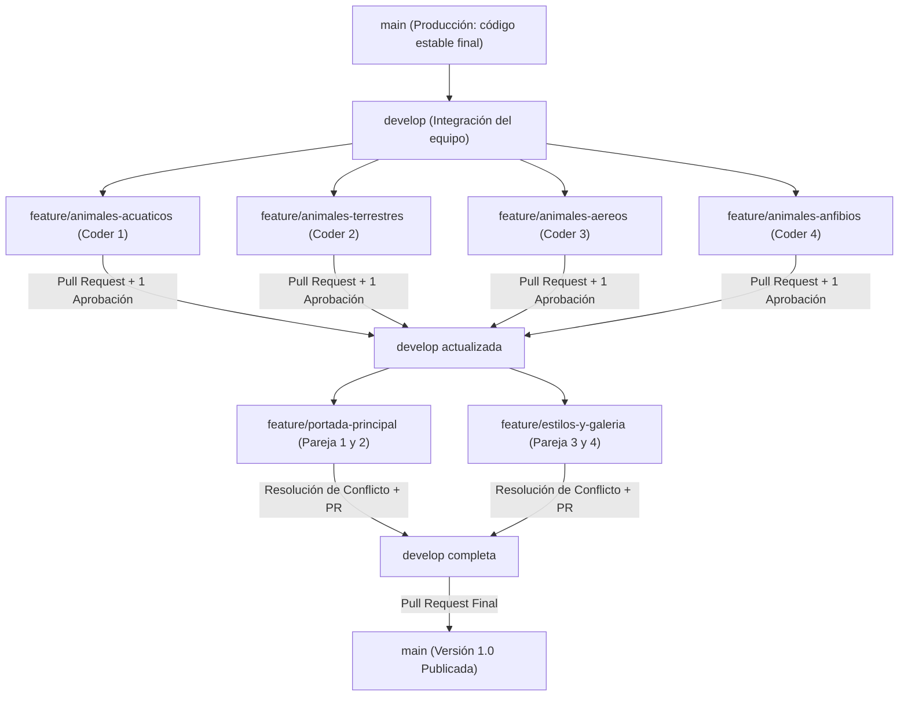

# 🐾 Taller Práctico en Equipo: Enciclopedia Web "Animalia" (Git, GitHub, GitFlow y Conventional Commits)

¡Bienvenidos al desarrollo colaborativo del portal web **Animalia**! En este taller construirán, en **equipos de 4 personas**, un sitio web informativo en **HTML5 y CSS3** dedicado a los cuatro grandes grupos del reino animal: **Acuáticos, Terrestres, Aéreos y Anfibios**.

Más allá del código web (el cual ya viene listo para copiar y pegar en sus guías individuales), el objetivo central es que vivan la experiencia real de un equipo de desarrollo de software trabajando sobre un mismo repositorio sin pisarse el trabajo, revisando el código de sus compañeros y resolviendo conflictos de código como profesionales.

---

## ⏱️ Duración Estimada y Plan de Trabajo (3 a 4 horas)

Este taller está diseñado para completarse en **3 a 4 horas de trabajo total**, idealmente distribuidas en **2 sesiones**:

| Etapa | Actividades Principales | Tiempo Estimado |
| :--- | :--- | :--- |
| **Etapa 0: Preparación del Equipo** | Elección del Líder, creación del repositorio en GitHub, reglas de protección de ramas, invitaciones y clonación local. | 30 min |
| **Etapa 1: Trabajo Individual por Módulo** | Creación de ramas `feature/*`, commits con *Conventional Commits*, subida de cambios (`push`) y primeros *Pull Requests* con revisión cruzada. | 60 - 75 min |
| 🏁 **Meta de la Sesión 1** | **Hasta aquí deberían llegar al finalizar la primera sesión (~1.5 a 2 horas):** las 4 páginas individuales (`acuaticos.html`, `terrestres.html`, `aereos.html`, `anfibios.html`) fusionadas en la rama `develop`. | — |
| **Etapa 2: Trabajo en Parejas y Conflictos** | Historias compartidas (Coders 1-2 y Coders 3-4), análisis del error de `push` rechazado, resolución de conflictos de *merge* en `index.html` y `styles.css`. | 75 - 90 min |
| **Etapa 3: Lanzamiento a Producción** | Integración final en `develop`, verificación del sitio completo y *Pull Request* de cierre de `develop` hacia `main`. | 15 - 20 min |

---

## 👥 Asignación de Roles y Guías Individuales

Antes de empezar, reúnanse los **4 integrantes del equipo** y elijan qué rol tomará cada uno. Además, **elijan a 1 persona para actuar como Líder del Repositorio** durante la configuración inicial (se recomienda que sea el **Coder 1**, pero puede ser cualquiera de los cuatro).

Cada integrante debe abrir su archivo de guía correspondiente y seguirlo paso a paso:

1. 🐬 **[Guía del Coder 1 (`coder-1.md`)](./coder-1.md)** — Especialista en **Animales Acuáticos** *(Pareja A junto al Coder 2)*.
2. 🦁 **[Guía del Coder 2 (`coder-2.md`)](./coder-2.md)** — Especialista en **Animales Terrestres** *(Pareja A junto al Coder 1)*.
3. 🦅 **[Guía del Coder 3 (`coder-3.md`)](./coder-3.md)** — Especialista en **Animales Aéreos** *(Pareja B junto al Coder 4)*.
4. 🐸 **[Guía del Coder 4 (`coder-4.md`)](./coder-4.md)** — Especialista en **Animales Anfibios** *(Pareja B junto al Coder 3)*.

---

## 🧠 Conceptos Clave antes de Empezar

### 1. ¿Qué es GitFlow (Flujo de Ramas)?

Cuando varias personas trabajan en el mismo proyecto, **nunca se trabaja directamente sobre la rama principal (`main`)**, porque un código incompleto o con errores dañaría la versión final de todo el equipo.

En este taller utilizaremos **GitFlow Práctico**, organizado en tres niveles de ramas:



- **`main`**: Rama de producción. Solo recibe código cuando todo el equipo ha terminado y probado el proyecto.
- **`develop`**: Rama de integración. De aquí nacen todas las ramas de trabajo y aquí se unen los avances mediante *Pull Requests*.
- **`feature/nombre-de-tarea`**: Ramas temporales donde trabajan de forma aislada o en pareja para construir una funcionalidad específica.

---

### 2. ¿Qué son los Conventional Commits (Convención de Commits)?

En lugar de escribir mensajes confusos como `"cambios"`, `"arreglado"` o `"subiendo mi parte"`, la industria utiliza el estándar **Conventional Commits**. Cada mensaje de commit sigue esta estructura estricta:

```text
tipo(alcance): descripción breve en minúsculas y sin punto final
```

#### Tipos de commits que usaremos en el taller:

| Tipo | ¿Cuándo se utiliza? | Ejemplo en este taller |
| :--- | :--- | :--- |
| **`feat`** | Cuando agregas una nueva página, sección o funcionalidad (*feature*). | `feat(acuaticos): add base structure and header for aquatic page` |
| **`style`** | Cuando creas o modificas estilos visuales en CSS o diseño. | `style(theme): update color palette and card hover effects` |
| **`fix`** | Cuando corriges un error o **resuelves un conflicto de merge**. | `fix(home): resolve merge conflict between aquatic and terrestrial sections` |
| **`docs`** | Cuando creas o actualizas documentación. | `docs(readme): add project setup instructions` |
| **`chore`** | Tareas de configuración inicial o cierre de versión. | `chore(init): add base index.html and styles.css structure` |

---

### 3. Comandos Esenciales de Git (Hoja de Referencia Rápida)

| Acción | Comando | ¿Para qué sirve? |
| :--- | :--- | :--- |
| **Clonar repositorio** | `git clone <URL-DEL-REPO>` | Descarga el repositorio remoto de GitHub a tu computador por primera vez. |
| **Ver estado** | `git status` | Muestra en qué rama estás, qué archivos modificaste y si hay conflictos. |
| **Ver ramas locales** | `git branch` | Lista las ramas en tu computador (el asterisco `*` marca tu rama actual). |
| **Traer ramas nuevas** | `git fetch origin` | Consulta a GitHub si tus compañeros crearon ramas o cambios nuevos sin mezclarlos aún. |
| **Cambiar de rama** | `git switch <nombre-rama>` *(o `git checkout <nombre-rama>`)* | Te mueve de tu rama actual a otra rama existente. |
| **Crear y cambiar a rama** | `git switch -c feature/mi-rama` *(o `git checkout -b feature/mi-rama`)* | Crea una rama nueva a partir de donde estás parado y te mueve a ella inmediatamente. |
| **Preparar archivos** | `git add <archivo>` *(o `git add .`)* | Pasa tus archivos modificados al área de preparación (*Staging Area*) para el próximo commit. |
| **Guardar commit** | `git commit -m "tipo(alcance): mensaje"` | Guarda una fotografía de tus cambios en tu historial local. |
| **Subir rama por 1ra vez** | `git push -u origin <nombre-rama>` | Sube tu rama nueva a GitHub y la deja conectada con la versión remota. |
| **Subir nuevos commits** | `git push origin <nombre-rama>` | Envía tus últimos commits locales a la rama en GitHub. |
| **Descargar e integrar** | `git pull --no-rebase origin <nombre-rama>` | Descarga los cambios que subió un compañero a GitHub y los fusiona con tu rama local. |

> [!TIP]
> **¿Por qué usamos `git pull --no-rebase origin <rama>`?**
> Dependiendo de cómo tengas instalado Git, a veces `git pull` intenta hacer un *rebase* en lugar de una fusión (*merge*). Al incluir `--no-rebase`, garantizamos que todos en el equipo vean exactamente el mismo comportamiento estándar de fusión (`merge`).

---

## 📋 Backlog General del Proyecto "Animalia"

A continuación se presenta la lista ordenada de entregas (**Backlog**) que el equipo debe completar para lanzar la enciclopedia web:

| ID | Historia / Requerimiento | Responsable(s) | Rama de Trabajo | Archivos Tocados | Estado Meta |
| :--- | :--- | :--- | :--- | :--- | :--- |
| **BASE** | Creación del repositorio, estructura base (`index.html`, `styles.css`), rama `develop` y protección de ramas. | **Líder del Equipo** | `main` -> `develop` | `index.html`, `styles.css` | Configuración |
| **HU-01** | **Módulo de Animales Acuáticos:** Como visitante, quiero una página dedicada a la fauna marina con fichas de especies y datos de hábitat. | **Coder 1** | `feature/animales-acuaticos` | `acuaticos.html` | Sesión 1 |
| **HU-02** | **Módulo de Animales Terrestres:** Como visitante, quiero una página dedicada a la fauna terrestre con fichas de especies continentales. | **Coder 2** | `feature/animales-terrestres` | `terrestres.html` | Sesión 1 |
| **HU-03** | **Módulo de Animales Aéreos:** Como visitante, quiero una página dedicada a las aves y fauna aérea con fichas de vuelo y envergadura. | **Coder 3** | `feature/animales-aereos` | `aereos.html` | Sesión 1 |
| **HU-04** | **Módulo de Animales Anfibios:** Como visitante, quiero una página dedicada a los anfibios y su ciclo de metamorfosis. | **Coder 4** | `feature/animales-anfibios` | `anfibios.html` | Sesión 1 |
| **HU-05** | **Portada Principal y Tarjetas de Acceso (En Pareja):** Como visitante, quiero ver en la portada un banner de bienvenida y el catálogo interactivo de reinos. *(Genera conflicto en `index.html`)*. | **Coder 1 y Coder 2** | `feature/portada-principal` | `index.html` | Sesión 2 |
| **HU-06** | **Sistema de Diseño CSS y Cierre de Catálogo (En Pareja):** Como visitante, quiero un diseño moderno con variables de color, cuadrícula responsiva y enlaces completos. *(Genera conflicto en `styles.css`)*. | **Coder 3 y Coder 4** | `feature/estilos-y-galeria` | `styles.css`, `index.html` | Sesión 2 |
| **REL-01** | **Lanzamiento a Producción v1.0:** Pase oficial de `develop` a `main` mediante Pull Request revisado por el equipo. | **Todo el Equipo** | `develop` -> `main` | Todos | Cierre Sesión 2 |

---

## 🛠️ Etapa 0: Configuración Inicial del Repositorio (Paso a Paso)

> [!IMPORTANT]
> **Atención equipo:** Los pasos **0.1 al 0.4** los ejecuta **únicamente el Líder del Equipo** (mientras los demás observan y aceptan la invitación). El paso **0.5** lo realizan **los otros 3 integrantes**.

### Paso 0.1: Crear el repositorio remoto en GitHub (Solo el Líder)

1. Inicia sesión en [GitHub](https://github.com) y haz clic en el botón **`+`** (arriba a la derecha) -> **`New repository`**.
2. En **Repository name**, escribe: `animalia-gitflow`
3. En **Visibility**, selecciona **Public** *(¡Muy importante! GitHub permite configurar reglas de bloqueo de Pull Requests de forma gratuita en repositorios públicos)*.
4. **No marques** *"Add a README file"* ni *.gitignore* (lo subiremos desde la consola para practicar los comandos desde cero).
5. Haz clic en **`Create repository`**. Deja abierta esa pestaña; necesitarás copiar la URL del repositorio (ejemplo: `https://github.com/tu-usuario/animalia-gitflow.git`).

---

### Paso 0.2: Subir el proyecto base y crear la rama `develop` (Solo el Líder)

1. Abre tu terminal (o la terminal integrada de VS Code) y crea la carpeta del proyecto ejecutando:

```bash
mkdir animalia-gitflow
cd animalia-gitflow
git init
git branch -M main
```

2. Crea el archivo `index.html` en la raíz de la carpeta `animalia-gitflow` y pega exactamente este contenido base:

```html
<!DOCTYPE html>
<html lang="es">
<head>
  <meta charset="UTF-8">
  <meta name="viewport" content="width=device-width, initial-scale=1.0">
  <title>Animalia | Enciclopedia del Reino Animal</title>
  <link rel="stylesheet" href="styles.css">
</head>
<body>
  <header class="site-header">
    <div class="container header-content">
      <h1 class="logo">🐾 Animalia</h1>
      <nav class="main-nav">
        <a href="index.html">Inicio</a>
        <a href="acuaticos.html">Acuáticos</a>
        <a href="terrestres.html">Terrestres</a>
        <a href="aereos.html">Aéreos</a>
        <a href="anfibios.html">Anfibios</a>
      </nav>
    </div>
  </header>

  <main class="container">
    <!-- ZONA DE CONFLICTO PAREJA A (CODERS 1 Y 2): HERO BANNER -->
    <section id="hero-banner" class="hero-banner">
      <h2>Bienvenidos a la Enciclopedia Animalia</h2>
      <p>Versión inicial en construcción por el equipo de desarrollo.</p>
    </section>

    <!-- ZONA DE TARJETAS DEL CATÁLOGO -->
    <section id="catalogo-reinos" class="catalogo-section">
      <h2>Explora los Reinos</h2>
      <div class="card-grid">
        <!-- Aquí se integrarán las tarjetas de cada categoría en la Fase 2 -->
        <article class="card">
          <h3>Próximamente</h3>
          <p>Los módulos de especies se están desarrollando en ramas separadas.</p>
        </article>
      </div>
    </section>
  </main>

  <footer class="site-footer">
    <p>Proyecto Colaborativo Animalia &mdash; Taller de Git &amp; GitFlow</p>
  </footer>
</body>
</html>
```

3. Crea ahora el archivo `styles.css` en la misma carpeta y pega este contenido base:

```css
/* =========================================================
   ZONA DE CONFLICTO PAREJA B (CODERS 3 Y 4): VARIABLES
   ========================================================= */
:root {
  --color-primario: #1e3a8a;
  --color-secundario: #0284c7;
  --color-fondo: #f8fafc;
  --color-texto: #1e293b;
  --color-blanco: #ffffff;
  --sombra-suave: 0 4px 12px rgba(0, 0, 0, 0.08);
}

* {
  box-sizing: border-box;
  margin: 0;
  padding: 0;
}

body {
  font-family: 'Segoe UI', Tahoma, Geneva, Verdana, sans-serif;
  background-color: var(--color-fondo);
  color: var(--color-texto);
  line-height: 1.6;
}

.container {
  max-width: 1050px;
  margin: 0 auto;
  padding: 0 20px;
}

.site-header {
  background-color: var(--color-primario);
  color: var(--color-blanco);
  padding: 18px 0;
  box-shadow: var(--sombra-suave);
}

.header-content {
  display: flex;
  justify-content: space-between;
  align-items: center;
  flex-wrap: wrap;
  gap: 12px;
}

.main-nav a {
  color: var(--color-blanco);
  text-decoration: none;
  margin-left: 16px;
  font-weight: 600;
  padding: 6px 12px;
  border-radius: 6px;
  transition: background-color 0.2s;
}

.main-nav a:hover {
  background-color: rgba(255, 255, 255, 0.2);
}

.hero-banner {
  background: var(--color-secundario);
  color: var(--color-blanco);
  padding: 40px 28px;
  border-radius: 12px;
  margin: 28px 0;
  text-align: center;
}

/* ZONA DE CONFLICTO PAREJA B: GRILLA Y TARJETAS */
.card-grid {
  display: grid;
  grid-template-columns: repeat(auto-fit, minmax(240px, 1fr));
  gap: 20px;
  margin: 24px 0 40px;
}

.card {
  background-color: var(--color-blanco);
  border-radius: 10px;
  padding: 20px;
  box-shadow: var(--sombra-suave);
  border-top: 4px solid var(--color-secundario);
}

.badge {
  display: inline-block;
  background-color: #e0f2fe;
  color: #0369a1;
  font-size: 0.82rem;
  font-weight: 700;
  padding: 4px 10px;
  border-radius: 999px;
  margin-top: 10px;
}

.site-footer {
  text-align: center;
  padding: 24px;
  background-color: #0f172a;
  color: #cbd5e1;
  margin-top: 40px;
}
```

4. Ahora haz el primer commit siguiendo **Conventional Commits**, conecta el repositorio con GitHub y sube tanto la rama `main` como la rama `develop`:

```bash
git add index.html styles.css
git commit -m "chore(init): add base index.html and styles.css structure"
git remote add origin <PEGA-AQUI-LA-URL-DE-TU-REPO>
git push -u origin main

# Crear la rama develop a partir de main y subirla a GitHub
git switch -c develop
git push -u origin develop
```

---

### Paso 0.3: Invitar a los otros 3 integrantes del equipo (Solo el Líder)

1. En la página de tu repositorio en GitHub, ve a la pestaña **`Settings`** (arriba a la derecha).
2. En el menú lateral izquierdo, haz clic en **`Collaborators`** (puede pedirte confirmar tu contraseña o código de GitHub).
3. Haz clic en el botón verde **`Add people`**.
4. Escribe el nombre de usuario de GitHub o correo de tus **3 compañeros** y envíales la invitación.
5. **¡Importante!** Tus 3 compañeros deben abrir su correo o entrar a `https://github.com/<usuario-lider>/animalia-gitflow/invitations` y hacer clic en **`Accept invitation`** antes de continuar.

---

### Paso 0.4: Configurar que los Pull Requests requieran mínimo 1 aprobación (Solo el Líder)

Para evitar que alguien fusione un Pull Request sin que otro compañero lo revise:

1. Dentro de **`Settings`** del repositorio en GitHub, ve al menú izquierdo y selecciona **`Branches`**.
2. En la sección **Branch protection rules**, haz clic en **`Add classic branch protection rule`** *(o si usas Rulesets modernos, haz clic en `Add branch ruleset`)*.
3. Si estás en **Classic branch protection rule**:
   - En **Branch name pattern**, escribe: `develop`
   - Marca la casilla ✅ **`Require a pull request before merging`**.
   - Justo debajo, asegúrate de que esté marcada ✅ **`Require approvals`** y que el número requerido sea **`1`**.
   - Baja hasta el final y haz clic en **`Create`** (o **`Save changes`**).
4. Repite exactamente el mismo proceso creando una segunda regla para el patrón `main` (o usando el patrón `main` y `develop`).

> [!NOTE]
> A partir de este momento, cuando cualquier integrante abra un Pull Request hacia `develop` o `main`, GitHub **bloqueará el botón de Merge** hasta que al menos 1 compañero del equipo revise el código y le dé el visto bueno (**Approve**).

---

### Paso 0.5: Clonar el repositorio en los equipos de los demás integrantes (Coders 2, 3 y 4)

Una vez que el Líder terminó los pasos anteriores y ustedes aceptaron la invitación:

1. Abran su terminal en la carpeta donde guardan sus proyectos (por ejemplo, `Desktop` o `Documentos`).
2. Ejecuten el comando `git clone` con la URL del repositorio del Líder:

```bash
git clone https://github.com/<USUARIO-DEL-LIDER>/animalia-gitflow.git
```

3. Entren a la carpeta del proyecto recién descargada y cámbiense inmediatamente a la rama de integración `develop`:

```bash
cd animalia-gitflow
git switch develop
```

4. Verifiquen con `git branch` que todos los 4 integrantes (incluido el Líder) estén situados sobre la rama `* develop`.

---

## 🔄 ¿Cómo crear y aprobar un Pull Request (PR) en GitHub?

Durante el taller tendrán que crear varios Pull Requests. Siempre sigan esta regla de oro:

> [!WARNING]
> **¡Cuidado con la rama destino!**
> En GitFlow, todas las ramas `feature/*` deben dirigirse hacia **`develop`**, **NO hacia `main`**. Por defecto, GitHub suele seleccionar `main` como rama base; **recuerda siempre cambiar `base: main` por `base: develop`** al abrir el Pull Request.

### Pasos para quien CREA el Pull Request:
1. Sube tu rama con `git push -u origin feature/nombre-de-tu-rama`.
2. Entra al repositorio en GitHub y haz clic en la pestaña **`Pull requests`** -> botón verde **`New pull request`** (o en el aviso amarillo **`Compare & pull request`** que aparece automáticamente).
3. Verifica las flechas en la parte superior:
   - **`base: develop`** ⬅️ **`compare: feature/nombre-de-tu-rama`**
4. Escribe un título claro (usando Conventional Commits, ej. `feat(acuaticos): add aquatic animals module`) y una breve descripción de lo que hiciste.
5. En la columna derecha, haz clic en **`Reviewers`** (el ícono del engranaje) y selecciona al compañero indicado en tu guía.
6. Haz clic en **`Create pull request`**.

### Pasos para quien REVISA y APRUEBA el Pull Request:
1. Entra a la pestaña **`Pull requests`** del repositorio en GitHub y abre el PR de tu compañero.
2. Haz clic en la pestaña **`Files changed`** (arriba) para inspeccionar el código que tu compañero agregó o modificó (aparecerá en color verde).
3. Haz clic en el botón verde **`Review changes`** (arriba a la derecha).
4. Escribe un comentario constructivo (ej. *"Excelente estructura HTML y commits bien nombrados, aprobado"*), selecciona la opción 🔘 **`Approve`** y haz clic en **`Submit review`**.
5. Una vez aprobado, el botón **`Merge pull request`** se habilitará en verde. Haz clic en **`Merge pull request`** -> **`Confirm merge`**.

---

## 💥 Guía de Supervivencia: Errores de Push y Conflictos de Merge

En la **Etapa 2 (Trabajo en Parejas)** provocarán a propósito los dos problemas más frecuentes de la vida real con Git. Aquí tienen la explicación de qué ocurre y cómo se soluciona:

### Problema 1: Error `! [rejected] ... (fetch first)` al intentar hacer `git push`

Cuando dos personas trabajan sobre la **misma rama remota** y tu compañero sube un commit antes que tú, al intentar ejecutar `git push` verás este mensaje de error en tu consola:

```text
To https://github.com/lider/animalia-gitflow.git
 ! [rejected]        feature/portada-principal -> feature/portada-principal (fetch first)
error: failed to push some refs to 'https://github.com/lider/animalia-gitflow.git'
hint: Updates were rejected because the remote contains work that you do
hint: not have locally. This is usually caused by another repository pushing
hint: to the same ref. You may want to first integrate the remote changes
hint: (e.g., 'git pull ...') before pushing again.
```

**¿Qué significa este mensaje?**
- **No rompiste nada.** Git te está protegiendo: te avisa que en GitHub (`remote`) hay commits nuevos de tu compañero que tú aún no tienes en tu computador (`locally`). Si Git te dejara forzar la subida, borrarías el trabajo de tu compañero.
- **¿Cómo se reacciona?** Nunca uses `git push --force`. Lo correcto es traer primero los cambios de tu compañero ejecutando:
  ```bash
  git pull --no-rebase origin <nombre-de-la-rama>
  ```

---

### Problema 2: `CONFLICT (content): Merge conflict` al hacer `git pull` o `git merge`

Si al ejecutar `git pull` resulta que tu compañero y tú modificaron **las mismas líneas del mismo archivo**, Git no puede adivinar cuál de los dos textos debe conservarse y mostrará este mensaje:

```text
Auto-merging index.html
CONFLICT (content): Merge conflict in index.html
Automatic merge failed; fix conflicts and then commit the result.
```

Al abrir el archivo en tu editor (como VS Code), verás que Git insertó **marcadores de conflicto**:

```html
<<<<<<< HEAD
      <h2>Explora las Profundidades y los Continentes</h2>
      <p>Desde los océanos abisales hasta las grandes llanuras.</p>
=======
      <h2>Conquista la Tierra Firme y los Ecosistemas</h2>
      <p>Conoce a las especies que dominan cada rincón del planeta.</p>
>>>>>>> 8f4a2c1b9e0d3a5f6b7c8d9e0f1a2b3c4d5e6f7a
```

#### ¿Qué significan estas marcas?
1. **`<<<<<<< HEAD`**: Desde aquí hasta los signos `=======` está **tu código local** (lo que tú escribiste en tu computador).
2. **`=======`**: Es la línea divisoria entre tu versión y la de tu compañero.
3. **`>>>>>>> <hash-del-commit>`**: Desde la línea divisoria hasta aquí está **el código entrante de tu compañero** (lo que vino desde GitHub).

#### Los 4 pasos para resolver un conflicto como un experto:
1. **Habla con tu compañero** y editen el archivo para dejar la versión final deseada (puede ser conservar uno, o combinar lo mejor de ambos bloques).
2. **Borra por completo las 3 líneas de marcadores** (`<<<<<<< HEAD`, `=======` y `>>>>>>> ...`). ¡No debe quedar ni un solo marcador en el archivo!
3. Guarda el archivo y dile a Git que el conflicto ya fue resuelto agregándolo al área de preparación:
   ```bash
   git add <archivo-que-tenia-conflicto>
   ```
4. Cierra la fusión con un commit de tipo `fix` y sube el resultado a GitHub:
   ```bash
   git commit -m "fix(alcance): resolve merge conflict in <archivo>"
   git push origin <nombre-de-la-rama>
   ```

---

## 🚀 ¡Comiencen el Desarrollo! (Ir a las Guías por Coder)

Una vez completada la **Etapa 0**, cada integrante debe abrir su guía personal y seguir las instrucciones paso a paso:

- 👉 **[Ir a `coder-1.md` (Animales Acuáticos + Pareja A)](./coder-1.md)**
- 👉 **[Ir a `coder-2.md` (Animales Terrestres + Pareja A)](./coder-2.md)**
- 👉 **[Ir a `coder-3.md` (Animales Aéreos + Pareja B)](./coder-3.md)**
- 👉 **[Ir a `coder-4.md` (Animales Anfibios + Pareja B)](./coder-4.md)**

---

## 🏁 Etapa 3: Lanzamiento Final a Producción (`develop` ➡️ `main`)

*(Realizar esta etapa únicamente cuando los 4 coders hayan completado todas las historias de sus guías individuales y los Pull Requests de las parejas estén fusionados en `develop`)*.

1. **Verificación grupal en local:**
   Todos los integrantes ejecutan en su terminal:
   ```bash
   git switch develop
   git pull --no-rebase origin develop
   ```
   Abran el archivo `index.html` con doble clic en su navegador web. Comprueben que:
   - La portada luce con el nuevo tema de colores y muestra las **4 tarjetas** (Acuáticos, Terrestres, Aéreos y Anfibios).
   - Al hacer clic en cada tarjeta o enlace del menú superior, navega correctamente a `acuaticos.html`, `terrestres.html`, `aereos.html` y `anfibios.html`.

2. **Pull Request de Lanzamiento (`Release` a `main`):**
   - El **Líder del Equipo** entra a GitHub -> **`Pull requests`** -> **`New pull request`**.
   - Selecciona las ramas: **`base: main`** ⬅️ **`compare: develop`**.
   - Título del PR: `chore(release): publish v1.0.0 of Animalia encyclopedia`
   - Asigna a los otros 3 compañeros en **`Reviewers`** y crea el Pull Request.
   - Los compañeros revisan los cambios acumulados, al menos uno aprueba el PR (**`Approve`**) y el Líder realiza el **`Merge pull request`** final.

3. **Sincronización final de `main`:**
   Para terminar con broche de oro, todos actualizan su rama `main` local:
   ```bash
   git switch main
   git pull --no-rebase origin main
   ```

🎉 **¡Felicitaciones equipo! Han completado el ciclo completo de desarrollo colaborativo con Git, GitHub, GitFlow y Conventional Commits.**
