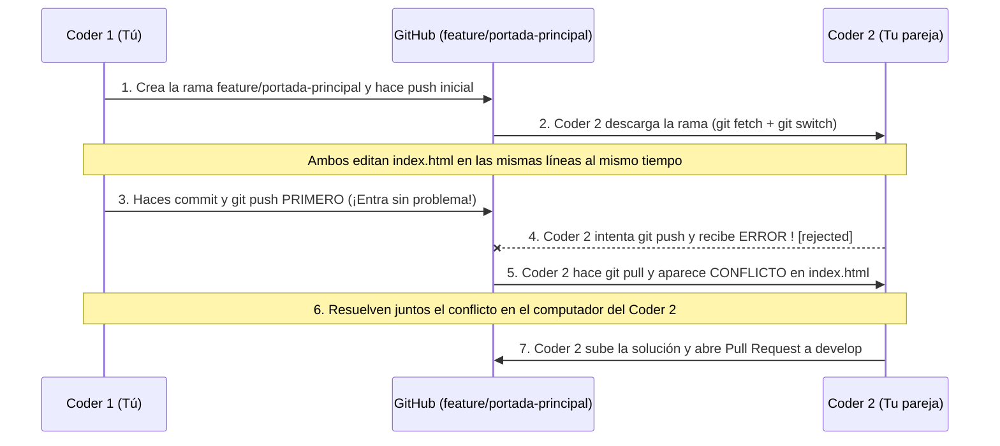

# 🐬 Guía del Coder 1: Especialista en Animales Acuáticos

¡Bienvenido/a al equipo de desarrollo de **Animalia**! En este proyecto eres responsable del módulo de **Animales Acuáticos** y formarás la **Pareja A** junto con el **Coder 2 (Animales Terrestres)**.

> [!NOTE]
> **¿Te eligieron como Líder del Equipo?**
> Si eres el Líder, asegúrate de haber completado primero la **Etapa 0** en el archivo [README.md](./README.md) (crear el repositorio en GitHub, subir `index.html` y `styles.css` iniciales, crear la rama `develop`, invitar a tus 3 compañeros y activar la regla de mínimo 1 aprobación para Pull Requests).

---

## 📌 Resumen de tus Entregas (Tu Backlog Personal)

| Historia | Descripción | Rama | Archivo que modificarás | Compañero de Revisión / Pareja |
| :--- | :--- | :--- | :--- | :--- |
| **HU-01** | Crear la página de **Animales Acuáticos** con cabecera, fichas de especies marinas y tabla de profundidades. | `feature/animales-acuaticos` | `acuaticos.html` | Revisa tu PR: **Coder 2** |
| **HU-05** | *(En pareja con Coder 2)* Rediseñar la portada principal y el catálogo de reinos, provocando y resolviendo un conflicto en equipo. | `feature/portada-principal` | `index.html` | Trabajo en pareja con **Coder 2** |

---

## 🚀 Etapa 1: Tu Historia de Usuario Individual (`HU-01`)

> **Historia de Usuario `HU-01`:**
> *Como visitante del portal Animalia, quiero una página dedicada a los animales acuáticos para conocer especies como el delfín, la ballena azul y el tiburón blanco junto con su hábitat y profundidad.*

### Paso 1.1: Asegurarte de estar en `develop` y crear tu rama `feature`

Antes de escribir una sola línea de código, verifica que estás en la carpeta del proyecto y sobre la rama `develop` actualizada:

```bash
git switch develop
git pull --no-rebase origin develop
```

Ahora crea tu propia rama de trabajo siguiendo el estándar **GitFlow** (`feature/nombre-de-tu-modulo`) y cámbiate a ella con un solo comando:

```bash
git switch -c feature/animales-acuaticos
```

Verifica con `git branch` que el asterisco `*` esté al lado de `feature/animales-acuaticos`.

> [!TIP]
> **¿Afecta esto a mis compañeros?**
> **No.** Como acabas de crear una rama local aislada (`feature/animales-acuaticos`) y trabajarás en un archivo nuevo (`acuaticos.html`), nada de lo que hagas aquí afectará el código de los Coders 2, 3 y 4 mientras ellos crean sus propias páginas.

---

### Paso 1.2: Primer Commit — Estructura base y primera especie (`acuaticos.html`)

1. En la carpeta raíz del proyecto (`animalia-gitflow`), crea un archivo nuevo llamado **`acuaticos.html`**.
2. Copia y pega el siguiente código HTML (contiene la estructura de la página y la primera tarjeta del Delfín):

```html
<!DOCTYPE html>
<html lang="es">
<head>
  <meta charset="UTF-8">
  <meta name="viewport" content="width=device-width, initial-scale=1.0">
  <title>Animales Acuáticos | Animalia</title>
  <link rel="stylesheet" href="styles.css">
</head>
<body>
  <header class="site-header">
    <div class="container header-content">
      <h1 class="logo">🐾 Animalia</h1>
      <nav class="main-nav">
        <a href="index.html">Inicio</a>
        <a href="acuaticos.html">Acuáticos</a>
        <a href="terrestres.html">Terrestres</a>
        <a href="aereos.html">Aéreos</a>
        <a href="anfibios.html">Anfibios</a>
      </nav>
    </div>
  </header>

  <main class="container">
    <section class="hero-banner">
      <h2>🌊 Reino de los Animales Acuáticos</h2>
      <p>Descubre las especies que habitan los océanos, arrecifes de coral y aguas profundas del planeta.</p>
    </section>

    <section class="catalogo-section">
      <h2>Especies Destacadas del Océano</h2>
      <div class="card-grid">
        <article class="card">
          <h3>🐬 Delfín Nariz de Botella</h3>
          <p>Mamífero marino altamente sociable e inteligente que utiliza la ecolocalización para comunicarse y cazar en grupo.</p>
          <span class="badge">Océanos Templados y Tropicales</span>
        </article>
      </div>
    </section>
  </main>

  <footer class="site-footer">
    <p>Módulo desarrollado por Coder 1 &mdash; Enciclopedia Animalia</p>
  </footer>
</body>
</html>
```

3. Guarda el archivo y registra tu primer commit aplicando **Conventional Commits**:

```bash
git status
git add acuaticos.html
git commit -m "feat(acuaticos): add base page structure and dolphin card"
```

---

### Paso 1.3: Segundo Commit — Completar el catálogo marino en `acuaticos.html`

En el desarrollo profesional no se sube todo en un único commit gigante, sino en pasos lógicos. Ahora agregaremos la **Ballena Azul** y el **Tiburón Blanco**.

1. Abre nuevamente **`acuaticos.html`** y reemplaza **todo su contenido** por esta versión completa:

```html
<!DOCTYPE html>
<html lang="es">
<head>
  <meta charset="UTF-8">
  <meta name="viewport" content="width=device-width, initial-scale=1.0">
  <title>Animales Acuáticos | Animalia</title>
  <link rel="stylesheet" href="styles.css">
</head>
<body>
  <header class="site-header">
    <div class="container header-content">
      <h1 class="logo">🐾 Animalia</h1>
      <nav class="main-nav">
        <a href="index.html">Inicio</a>
        <a href="acuaticos.html">Acuáticos</a>
        <a href="terrestres.html">Terrestres</a>
        <a href="aereos.html">Aéreos</a>
        <a href="anfibios.html">Anfibios</a>
      </nav>
    </div>
  </header>

  <main class="container">
    <section class="hero-banner">
      <h2>🌊 Reino de los Animales Acuáticos</h2>
      <p>Descubre las especies que habitan los océanos, arrecifes de coral y aguas profundas del planeta.</p>
    </section>

    <section class="catalogo-section">
      <h2>Especies Destacadas del Océano</h2>
      <div class="card-grid">
        <article class="card">
          <h3>🐬 Delfín Nariz de Botella</h3>
          <p>Mamífero marino altamente sociable e inteligente que utiliza la ecolocalización para comunicarse y cazar en grupo.</p>
          <span class="badge">Profundidad: 0 - 300 m</span>
        </article>

        <article class="card">
          <h3>🐋 Ballena Azul</h3>
          <p>El animal más grande que ha existido en la Tierra. Puede medir hasta 30 metros de longitud y se alimenta principalmente de krill.</p>
          <span class="badge">Profundidad: 0 - 500 m</span>
        </article>

        <article class="card">
          <h3>🦈 Gran Tiburón Blanco</h3>
          <p>Depredador ápice de los mares con un sentido del olfato extraordinario y capacidad para detectar campos electromagnéticos.</p>
          <span class="badge">Profundidad: 0 - 1,200 m</span>
        </article>
      </div>
    </section>
  </main>

  <footer class="site-footer">
    <p>Módulo desarrollado por Coder 1 &mdash; Enciclopedia Animalia</p>
  </footer>
</body>
</html>
```

2. Guarda los cambios y realiza tu segundo commit:

```bash
git add acuaticos.html
git commit -m "feat(acuaticos): add blue whale and great white shark cards"
```

---

### Paso 1.4: Subir tu rama a GitHub y abrir tu primer Pull Request

1. Sube tu rama `feature/animales-acuaticos` al repositorio remoto en GitHub:

```bash
git push -u origin feature/animales-acuaticos
```

2. Ve al repositorio en GitHub desde tu navegador:
   - Haz clic en **`Compare & pull request`** (o ve a **`Pull requests`** -> **`New pull request`**).
   - ⚠️ **¡Atención!** Cambia la rama destino para que quede así:
     **`base: develop`** ⬅️ **`compare: feature/animales-acuaticos`**
   - **Título del PR:** `feat(acuaticos): complete aquatic animals module (HU-01)`
   - **Descripción:** `Agrega la página acuaticos.html con las fichas del delfín, ballena azul y tiburón blanco.`
   - En la barra derecha, en **`Reviewers`**, selecciona al **Coder 2**.
   - Haz clic en **`Create pull request`**.

> [!IMPORTANT]
> **🔔 Cómo afecta esta acción al Coder 2:**
> Avísale al **Coder 2** que ya creaste tu Pull Request. Él/ella deberá entrar a GitHub, revisar tu archivo en *Files changed*, darle a **`Approve`** y hacer clic en **`Merge pull request`**.
>
> **Tu tarea recíproca:** Cuando el **Coder 2** suba su rama `feature/animales-terrestres` y te asigne como revisor de su PR, entra a **`Pull requests`**, revisa su archivo `terrestres.html`, selecciona **`Review changes` -> `Approve` -> `Submit review`** y haz el **`Merge pull request`**.

---

### 🏁 Punto de Control (Fin estimado de la Sesión 1)

Espera a que los **4 integrantes del equipo** hayan fusionado sus Pull Requests individuales (`HU-01`, `HU-02`, `HU-03` y `HU-04`) dentro de `develop`. Cuando todos estén listos, regresa a tu rama `develop` y descarga el trabajo de todo el equipo:

```bash
git switch develop
git pull --no-rebase origin develop
```

¡Observa tu carpeta! Ahora tienes en tu computador los archivos `acuaticos.html`, `terrestres.html`, `aereos.html` y `anfibios.html` que crearon tus compañeros.

---

## 💥 Etapa 2: Trabajo en Pareja y Conflicto de Merge (`HU-05`)

> **Historia de Usuario `HU-05` (Pareja A: Coder 1 + Coder 2):**
> *Como visitante del sitio, quiero que la página principal (`index.html`) tenga un banner renovado y muestre las tarjetas de enlace hacia los 4 reinos animales.*

En esta historia trabajarás **al mismo tiempo que el Coder 2 sobre el mismo archivo (`index.html`) y sobre la misma rama (`feature/portada-principal`)** para experimentar qué ocurre cuando dos desarrolladores modifican las mismas líneas de código.



---

### Paso 2.1: Crear y compartir la rama `feature/portada-principal`

1. Asegúrate de estar en `develop` actualizado:

```bash
git switch develop
git pull --no-rebase origin develop
```

2. Crea la rama compartida para la Pareja A y súbela a GitHub para que el **Coder 2** pueda conectarse a ella:

```bash
git switch -c feature/portada-principal
git push -u origin feature/portada-principal
```

> [!IMPORTANT]
> **🔔 Punto de Sincronización 1 con el Coder 2:**
> Dile al **Coder 2**: *"Ya subí la rama `feature/portada-principal` a GitHub"*.
> **Espera un momento** hasta que el Coder 2 ejecute `git fetch origin` y `git switch feature/portada-principal` en su computador. Cuando ambos estén parados en `feature/portada-principal`, pasen juntos al **Paso 2.2**.

---

### Paso 2.2: Modificar `index.html` y hacer `push` PRIMERO

1. Abre el archivo **`index.html`** en tu editor y reemplaza **todo su contenido** por el siguiente código (fíjate que estás cambiando el texto de `#hero-banner` y agregando las tarjetas de Acuáticos y Aéreos en `#catalogo-reinos`):

```html
<!DOCTYPE html>
<html lang="es">
<head>
  <meta charset="UTF-8">
  <meta name="viewport" content="width=device-width, initial-scale=1.0">
  <title>Animalia | Enciclopedia del Reino Animal</title>
  <link rel="stylesheet" href="styles.css">
</head>
<body>
  <header class="site-header">
    <div class="container header-content">
      <h1 class="logo">🐾 Animalia</h1>
      <nav class="main-nav">
        <a href="index.html">Inicio</a>
        <a href="acuaticos.html">Acuáticos</a>
        <a href="terrestres.html">Terrestres</a>
        <a href="aereos.html">Aéreos</a>
        <a href="anfibios.html">Anfibios</a>
      </nav>
    </div>
  </header>

  <main class="container">
    <!-- ZONA DE CONFLICTO PAREJA A (CODERS 1 Y 2): HERO BANNER -->
    <section id="hero-banner" class="hero-banner">
      <h2>Explora las Profundidades del Océano y los Cielos</h2>
      <p>Sumérgete en nuestra enciclopedia interactiva de biodiversidad marina y continental.</p>
    </section>

    <!-- ZONA DE TARJETAS DEL CATÁLOGO -->
    <section id="catalogo-reinos" class="catalogo-section">
      <h2>Explora los Reinos</h2>
      <div class="card-grid">
        <article class="card">
          <h3>🌊 Animales Acuáticos</h3>
          <p>Delfines, ballenas azules y grandes tiburones que dominan los océanos.</p>
          <a href="acuaticos.html" class="badge">Explorar módulo &rarr;</a>
        </article>

        <article class="card">
          <h3>🦅 Animales Aéreos</h3>
          <p>Águilas, halcones peregrinos y colibríes maestros de las alturas.</p>
          <a href="aereos.html" class="badge">Explorar módulo &rarr;</a>
        </article>
      </div>
    </section>
  </main>

  <footer class="site-footer">
    <p>Proyecto Colaborativo Animalia &mdash; Taller de Git &amp; GitFlow</p>
  </footer>
</body>
</html>
```

2. Guarda el archivo `index.html`, haz tu commit y **súbelo inmediatamente a GitHub antes que el Coder 2**:

```bash
git add index.html
git commit -m "feat(home): update hero banner and add aquatic and aerial cards"
git push origin feature/portada-principal
```

> [!WARNING]
> **🔔 ¡Acabas de afectar directamente al Coder 2!**
> Como tú hiciste `git push` primero, tu cambio ya está guardado en GitHub.
> Sin embargo, el **Coder 2** está editando las **mismas líneas** de `index.html` en su computador basándose en la versión anterior.
>
> **¿Qué debes hacer ahora?**
> 1. Avísale al **Coder 2**: *"Ya hice mi push en `feature/portada-principal`, intenta hacer el tuyo"*.
> 2. Acércate o mira la pantalla del **Coder 2** para observar los dos mensajes que le van a aparecer y ayúdale a resolver el conflicto siguiendo los pasos que te mostramos a continuación.

---

### Paso 2.3: Entender el Error de Push y Resolver el Conflicto junto al Coder 2

Aunque el conflicto ocurrirá en la terminal del **Coder 2**, es fundamental que ambos entiendan qué sucede y lo resuelvan juntos:

#### 1. El error al intentar hacer `git push`:
Cuando el Coder 2 ejecute `git push origin feature/portada-principal`, Git le responderá:
```text
 ! [rejected]        feature/portada-principal -> feature/portada-principal (fetch first)
error: failed to push some refs to 'https://github.com/...'
hint: Updates were rejected because the remote contains work that you do
hint: not have locally.
```
- **Explicación:** GitHub detectó tu commit (`feat(home): update hero banner and add aquatic and aerial cards`) y le impide al Coder 2 sobrescribir tu trabajo.

#### 2. El conflicto al ejecutar `git pull --no-rebase origin feature/portada-principal`:
Cuando el Coder 2 descargue tus cambios para integrarlos con los suyos, aparecerá:
```text
Auto-merging index.html
CONFLICT (content): Merge conflict in index.html
Automatic merge failed; fix conflicts and then commit the result.
```
Y dentro del archivo `index.html` del Coder 2 se verán las marcas `<<<<<<< HEAD` (el código del Coder 2), `=======` (el separador) y `>>>>>>> ...` (tu código).

#### 3. Solución en equipo:
Ayúdale al **Coder 2** a borrar las marcas `<<<<<<< HEAD`, `=======` y `>>>>>>>`, y a dejar el `index.html` unificado con **las 4 tarjetas de animales** (tal como se indica en el Paso 2.4 de la guía del Coder 2).

---

### Paso 2.4: Revisar y Aprobar el Pull Request de la Pareja A

Una vez que el **Coder 2** haya hecho el commit de solución (`fix(home): resolve merge conflict and integrate all four animal kingdom cards`), haya subido los cambios a GitHub y haya creado el Pull Request de `feature/portada-principal` hacia `develop`:

1. Primero, si quieres ver cómo quedó la rama resuelta en tu computador, ejecuta:
   ```bash
   git pull --no-rebase origin feature/portada-principal
   ```
2. Entra a GitHub -> pestaña **`Pull requests`**.
3. Abre el Pull Request **`feat(home): integrate main landing page and kingdom catalog (HU-05)`** creado por el Coder 2.
4. Ve a **`Files changed`**, verifica que `index.html` tenga las 4 tarjetas y ningún marcador de conflicto, haz clic en **`Review changes`** -> selecciona 🔘 **`Approve`** -> **`Submit review`**.
5. Haz clic en **`Merge pull request`** -> **`Confirm merge`**.

---

## 🎉 Cierre de tu Participación: Ir a la Etapa 3 Grupal

¡Excelente trabajo! Cuando la **Pareja B (Coders 3 y 4)** también haya fusionado su Pull Request de estilos en `develop`, reúnanse los 4 integrantes y sigan las instrucciones finales de la **Etapa 3: Lanzamiento Final a Producción (`develop` ➡️ `main`)** al final del archivo [README.md](./README.md).
