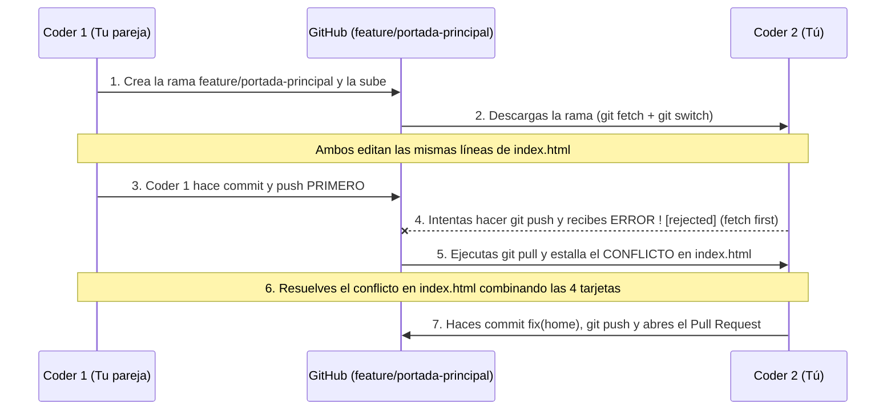

# 🦁 Guía del Coder 2: Especialista en Animales Terrestres

¡Bienvenido/a al equipo de desarrollo de **Animalia**! En este proyecto eres responsable del módulo de **Animales Terrestres** y formarás la **Pareja A** junto con el **Coder 1 (Animales Acuáticos)**.

> [!NOTE]
> **Antes de empezar esta guía:**
> Asegúrate de que el Líder del Equipo haya terminado la **Etapa 0** del [README.md](./README.md), de haber aceptado la invitación en GitHub y de haber clonado el repositorio en tu computador (`git clone <URL>`, `cd animalia-gitflow` y `git switch develop`).

---

## 📌 Resumen de tus Entregas (Tu Backlog Personal)

| Historia | Descripción | Rama | Archivo que modificarás | Compañero de Revisión / Pareja |
| :--- | :--- | :--- | :--- | :--- |
| **HU-02** | Crear la página de **Animales Terrestres** con cabecera y fichas del León Africano, Elefante y Guepardo. | `feature/animales-terrestres` | `terrestres.html` | Revisa tu PR: **Coder 1** |
| **HU-05** | *(En pareja con Coder 1)* Rediseñar la portada principal (`index.html`), experimentar el error de `push` rechazado y **resolver el conflicto de merge**. | `feature/portada-principal` | `index.html` | Trabajo en pareja con **Coder 1** |

---

## 🚀 Etapa 1: Tu Historia de Usuario Individual (`HU-02`)

> **Historia de Usuario `HU-02`:**
> *Como visitante del portal Animalia, quiero una página dedicada a los animales terrestres para conocer especies continentales como el león africano, el elefante de sabana y el guepardo.*

### Paso 1.1: Asegurarte de estar en `develop` y crear tu rama `feature`

1. En la terminal dentro de la carpeta `animalia-gitflow`, asegúrate de estar en la rama `develop` actualizada:

```bash
git switch develop
git pull --no-rebase origin develop
```

2. Crea tu rama para la funcionalidad de animales terrestres y cámbiate a ella:

```bash
git switch -c feature/animales-terrestres
```

3. Comprueba con `git branch` que estás ubicado en `* feature/animales-terrestres`.

> [!TIP]
> **¿Afecta esto a mis compañeros?**
> **No.** Estás trabajando en tu propia rama (`feature/animales-terrestres`) y sobre un archivo nuevo (`terrestres.html`), por lo que tus compañeros pueden avanzar en paralelo sin ningún choque.

---

### Paso 1.2: Primer Commit — Estructura base y primera especie (`terrestres.html`)

1. Crea en la raíz del proyecto un archivo nuevo llamado **`terrestres.html`**.
2. Copia y pega el siguiente código HTML inicial:

```html
<!DOCTYPE html>
<html lang="es">
<head>
  <meta charset="UTF-8">
  <meta name="viewport" content="width=device-width, initial-scale=1.0">
  <title>Animales Terrestres | Animalia</title>
  <link rel="stylesheet" href="styles.css">
</head>
<body>
  <header class="site-header">
    <div class="container header-content">
      <h1 class="logo">🐾 Animalia</h1>
      <nav class="main-nav">
        <a href="index.html">Inicio</a>
        <a href="acuaticos.html">Acuáticos</a>
        <a href="terrestres.html">Terrestres</a>
        <a href="aereos.html">Aéreos</a>
        <a href="anfibios.html">Anfibios</a>
      </nav>
    </div>
  </header>

  <main class="container">
    <section class="hero-banner">
      <h2>🦁 Reino de los Animales Terrestres</h2>
      <p>Conoce a las especies que dominan las sabanas, selvas tropicales, bosques y montañas.</p>
    </section>

    <section class="catalogo-section">
      <h2>Especies Destacadas de los Continentes</h2>
      <div class="card-grid">
        <article class="card">
          <h3>🦁 León Africano</h3>
          <p>El único gran felino que vive en manadas organizadas. Habita las sabanas y pastizales del África subsahariana.</p>
          <span class="badge">Hábitat: Sabana Africana</span>
        </article>
      </div>
    </section>
  </main>

  <footer class="site-footer">
    <p>Módulo desarrollado por Coder 2 &mdash; Enciclopedia Animalia</p>
  </footer>
</body>
</html>
```

3. Guarda el archivo y registra tu primer commit con **Conventional Commits**:

```bash
git status
git add terrestres.html
git commit -m "feat(terrestres): add base page structure and lion card"
```

---

### Paso 1.3: Segundo Commit — Agregar Elefante y Guepardo en `terrestres.html`

1. Abre **`terrestres.html`** y reemplaza **todo su contenido** por esta versión completa con las 3 especies:

```html
<!DOCTYPE html>
<html lang="es">
<head>
  <meta charset="UTF-8">
  <meta name="viewport" content="width=device-width, initial-scale=1.0">
  <title>Animales Terrestres | Animalia</title>
  <link rel="stylesheet" href="styles.css">
</head>
<body>
  <header class="site-header">
    <div class="container header-content">
      <h1 class="logo">🐾 Animalia</h1>
      <nav class="main-nav">
        <a href="index.html">Inicio</a>
        <a href="acuaticos.html">Acuáticos</a>
        <a href="terrestres.html">Terrestres</a>
        <a href="aereos.html">Aéreos</a>
        <a href="anfibios.html">Anfibios</a>
      </nav>
    </div>
  </header>

  <main class="container">
    <section class="hero-banner">
      <h2>🦁 Reino de los Animales Terrestres</h2>
      <p>Conoce a las especies que dominan las sabanas, selvas tropicales, bosques y montañas.</p>
    </section>

    <section class="catalogo-section">
      <h2>Especies Destacadas de los Continentes</h2>
      <div class="card-grid">
        <article class="card">
          <h3>🦁 León Africano</h3>
          <p>El único gran felino que vive en manadas organizadas. Habita las sabanas y pastizales del África subsahariana.</p>
          <span class="badge">Velocidad máx: 80 km/h</span>
        </article>

        <article class="card">
          <h3>🐘 Elefante Africano de Sabana</h3>
          <p>El mamífero terrestre de mayor tamaño. Posee una memoria excepcional y una trompa con más de 40,000 músculos.</p>
          <span class="badge">Peso: Hasta 6,000 kg</span>
        </article>

        <article class="card">
          <h3>🐆 Guepardo (Chita)</h3>
          <p>El animal terrestre más veloz del planeta, capaz de acelerar de 0 a 100 km/h en tan solo tres segundos.</p>
          <span class="badge">Velocidad máx: 115 km/h</span>
        </article>
      </div>
    </section>
  </main>

  <footer class="site-footer">
    <p>Módulo desarrollado por Coder 2 &mdash; Enciclopedia Animalia</p>
  </footer>
</body>
</html>
```

2. Guarda el archivo y realiza tu segundo commit:

```bash
git add terrestres.html
git commit -m "feat(terrestres): add african elephant and cheetah cards"
```

---

### Paso 1.4: Subir tu rama a GitHub y abrir tu Pull Request

1. Sube tu rama `feature/animales-terrestres` a GitHub:

```bash
git push -u origin feature/animales-terrestres
```

2. Ve al repositorio en GitHub:
   - Haz clic en **`Compare & pull request`** (o ve a **`Pull requests`** -> **`New pull request`**).
   - ⚠️ **¡Atención!** Asegúrate de cambiar la rama destino a **`develop`**:
     **`base: develop`** ⬅️ **`compare: feature/animales-terrestres`**
   - **Título del PR:** `feat(terrestres): complete terrestrial animals module (HU-02)`
   - **Descripción:** `Agrega la página terrestres.html con las fichas del león africano, elefante y guepardo.`
   - En **`Reviewers`** (columna derecha), selecciona al **Coder 1**.
   - Haz clic en **`Create pull request`**.

> [!IMPORTANT]
> **🔔 Interacción con el Coder 1:**
> - Pídele al **Coder 1** que revise, apruebe (**`Approve`**) y fusione (**`Merge`**) tu Pull Request.
> - **Tu tarea recíproca:** Entra a la pestaña **`Pull requests`**, abre el PR del **Coder 1** (`feature/animales-acuaticos`), revisa su archivo `acuaticos.html` en **`Files changed`**, haz clic en **`Review changes` -> `Approve` -> `Submit review`** y luego presiona **`Merge pull request`**.

---

### 🏁 Punto de Control (Fin estimado de la Sesión 1)

Cuando los **4 integrantes del equipo** hayan fusionado sus Pull Requests individuales (`HU-01` a `HU-04`) en `develop`, actualiza tu rama `develop` local:

```bash
git switch develop
git pull --no-rebase origin develop
```

---

## 💥 Etapa 2: Trabajo en Pareja, Error de Push y Resolución de Conflicto (`HU-05`)

> **Historia de Usuario `HU-05` (Pareja A: Coder 1 + Coder 2):**
> *Como visitante del sitio, quiero que la portada principal (`index.html`) tenga un banner renovado y muestre las tarjetas de enlace hacia los 4 reinos animales.*

En esta actividad trabajarás sobre la misma rama (`feature/portada-principal`) y el mismo archivo (`index.html`) que el **Coder 1**. **Tú serás quien experimente en tu terminal el error de rechazo de `git push` y quien resuelva el conflicto de merge con ayuda del Coder 1.**



---

### Paso 2.1: Conectarte a la rama compartida `feature/portada-principal`

> [!IMPORTANT]
> **🔔 Punto de Sincronización 1 (Espera al Coder 1):**
> Espera a que el **Coder 1** te confirme que ya creó y subió a GitHub la rama `feature/portada-principal`.

Una vez que el Coder 1 te avise, descarga la lista de ramas nuevas de GitHub y cámbiate a `feature/portada-principal`:

```bash
git fetch origin
git switch feature/portada-principal
```

Verifica con `git branch` que estás sobre `* feature/portada-principal`.

---

### Paso 2.2: Modificar las mismas líneas de `index.html` y hacer tu commit local

1. Abre el archivo **`index.html`** y reemplaza **todo su contenido** por este código (observa que estás editando `#hero-banner` y `#catalogo-reinos` con las tarjetas de Terrestres y Anfibios, exactamente en las mismas líneas donde el Coder 1 está poniendo las de Acuáticos y Aéreos):

```html
<!DOCTYPE html>
<html lang="es">
<head>
  <meta charset="UTF-8">
  <meta name="viewport" content="width=device-width, initial-scale=1.0">
  <title>Animalia | Enciclopedia del Reino Animal</title>
  <link rel="stylesheet" href="styles.css">
</head>
<body>
  <header class="site-header">
    <div class="container header-content">
      <h1 class="logo">🐾 Animalia</h1>
      <nav class="main-nav">
        <a href="index.html">Inicio</a>
        <a href="acuaticos.html">Acuáticos</a>
        <a href="terrestres.html">Terrestres</a>
        <a href="aereos.html">Aéreos</a>
        <a href="anfibios.html">Anfibios</a>
      </nav>
    </div>
  </header>

  <main class="container">
    <!-- ZONA DE CONFLICTO PAREJA A (CODERS 1 Y 2): HERO BANNER -->
    <section id="hero-banner" class="hero-banner">
      <h2>Recorre los Continentes y Selvas Húmedas</h2>
      <p>Conoce de cerca a los grandes mamíferos terrestres y los anfibios más fascinantes.</p>
    </section>

    <!-- ZONA DE TARJETAS DEL CATÁLOGO -->
    <section id="catalogo-reinos" class="catalogo-section">
      <h2>Explora los Reinos</h2>
      <div class="card-grid">
        <article class="card">
          <h3>🦁 Animales Terrestres</h3>
          <p>Leones, elefantes y guepardos que recorren las grandes sabanas y selvas.</p>
          <a href="terrestres.html" class="badge">Explorar módulo &rarr;</a>
        </article>

        <article class="card">
          <h3>🐸 Animales Anfibios</h3>
          <p>Ranas dardo, ajolotes y salamandras maestros de la metamorfosis.</p>
          <a href="anfibios.html" class="badge">Explorar módulo &rarr;</a>
        </article>
      </div>
    </section>
  </main>

  <footer class="site-footer">
    <p>Proyecto Colaborativo Animalia &mdash; Taller de Git &amp; GitFlow</p>
  </footer>
</body>
</html>
```

2. Guarda el archivo y registra tu commit local:

```bash
git add index.html
git commit -m "feat(home): update hero banner and add terrestrial and amphibian cards"
```

---

### Paso 2.3: Intentar hacer `git push` y analizar el Error de Rechazo

> [!IMPORTANT]
> **🔔 Punto de Sincronización 2 (Espera el push del Coder 1):**
> **Asegúrate de que el Coder 1 haya ejecutado su `git push origin feature/portada-principal` PRIMERO.**
> Cuando el Coder 1 te confirme que ya subió sus cambios, ejecuta tú el siguiente comando:

```bash
git push origin feature/portada-principal
```

#### 💥 ¡Mira tu terminal! Verás este mensaje de error:

```text
To https://github.com/lider/animalia-gitflow.git
 ! [rejected]        feature/portada-principal -> feature/portada-principal (fetch first)
error: failed to push some refs to 'https://github.com/lider/animalia-gitflow.git'
hint: Updates were rejected because the remote contains work that you do
hint: not have locally. This is usually caused by another repository pushing
hint: to the same ref. You may want to first integrate the remote changes
hint: (e.g., 'git pull ...') before pushing again.
```

**¿Por qué falló tu `git push`?**
Porque el **Coder 1** subió un commit nuevo a `feature/portada-principal` hace unos segundos. Tu computador no tiene ese commit todavía (`the remote contains work that you do not have locally`), así que Git bloquea tu subida para que no borres por accidente el trabajo de tu compañero.

---

### Paso 2.4: Hacer `git pull` y Resolver el Conflicto de Merge en `index.html`

1. Siguiendo la recomendación que el propio Git te da en el mensaje (`hint: 'git pull ...'`), descarga e intenta fusionar los cambios que subió el Coder 1:

```bash
git pull --no-rebase origin feature/portada-principal
```

2. **¡Acaba de estallar el conflicto!** En tu terminal aparecerá:

```text
Auto-merging index.html
CONFLICT (content): Merge conflict in index.html
Automatic merge failed; fix conflicts and then commit the result.
```

3. Abre el archivo **`index.html`** en tu editor de código (junto con el Coder 1). Verás que Git colocó las marcas de conflicto exactamente donde chocaron sus cambios:

```html
<<<<<<< HEAD
    <section id="hero-banner" class="hero-banner">
      <h2>Recorre los Continentes y Selvas Húmedas</h2>
      <p>Conoce de cerca a los grandes mamíferos terrestres y los anfibios más fascinantes.</p>
    </section>
...
=======
    <section id="hero-banner" class="hero-banner">
      <h2>Explora las Profundidades del Océano y los Cielos</h2>
      <p>Sumérgete en nuestra enciclopedia interactiva de biodiversidad marina y continental.</p>
    </section>
...
>>>>>>> (hash del commit del Coder 1)
```

4. **Cómo solucionarlo:**
   - **No queremos perder el trabajo de ninguno de los dos.** Queremos combinar ambos aportes para que la portada tenga las **4 tarjetas** (Acuáticos, Terrestres, Aéreos y Anfibios) y eliminar todos los símbolos `<<<<<<< HEAD`, `=======` y `>>>>>>>`.
   - Reemplaza **todo el contenido de `index.html`** por esta versión limpia y unificada:

```html
<!DOCTYPE html>
<html lang="es">
<head>
  <meta charset="UTF-8">
  <meta name="viewport" content="width=device-width, initial-scale=1.0">
  <title>Animalia | Enciclopedia del Reino Animal</title>
  <link rel="stylesheet" href="styles.css">
</head>
<body>
  <header class="site-header">
    <div class="container header-content">
      <h1 class="logo">🐾 Animalia</h1>
      <nav class="main-nav">
        <a href="index.html">Inicio</a>
        <a href="acuaticos.html">Acuáticos</a>
        <a href="terrestres.html">Terrestres</a>
        <a href="aereos.html">Aéreos</a>
        <a href="anfibios.html">Anfibios</a>
      </nav>
    </div>
  </header>

  <main class="container">
    <!-- PORTADA UNIFICADA POR CODERS 1 Y 2 -->
    <section id="hero-banner" class="hero-banner">
      <h2>Explora los Océanos, Continentes, Cielos y Selvas Húmedas</h2>
      <p>Sumérgete en nuestra enciclopedia interactiva de biodiversidad marina, terrestre, aérea y anfibia.</p>
    </section>

    <!-- CATÁLOGO COMPLETO CON LAS 4 CATEGORÍAS -->
    <section id="catalogo-reinos" class="catalogo-section">
      <h2>Explora los Reinos</h2>
      <div class="card-grid">
        <article class="card">
          <h3>🌊 Animales Acuáticos</h3>
          <p>Delfines, ballenas azules y grandes tiburones que dominan los océanos.</p>
          <a href="acuaticos.html" class="badge">Explorar módulo &rarr;</a>
        </article>

        <article class="card">
          <h3>🦁 Animales Terrestres</h3>
          <p>Leones, elefantes y guepardos que recorren las grandes sabanas y selvas.</p>
          <a href="terrestres.html" class="badge">Explorar módulo &rarr;</a>
        </article>

        <article class="card">
          <h3>🦅 Animales Aéreos</h3>
          <p>Águilas, halcones peregrinos y colibríes maestros de las alturas.</p>
          <a href="aereos.html" class="badge">Explorar módulo &rarr;</a>
        </article>

        <article class="card">
          <h3>🐸 Animales Anfibios</h3>
          <p>Ranas dardo, ajolotes y salamandras maestros de la metamorfosis.</p>
          <a href="anfibios.html" class="badge">Explorar módulo &rarr;</a>
        </article>
      </div>
    </section>
  </main>

  <footer class="site-footer">
    <p>Proyecto Colaborativo Animalia &mdash; Taller de Git &amp; GitFlow</p>
  </footer>
</body>
</html>
```

5. Guarda el archivo `index.html`. Ahora márcalo como resuelto con `git add`, crea el commit de solución usando `fix(home)` y sube los cambios a GitHub:

```bash
git status
git add index.html
git commit -m "fix(home): resolve merge conflict and integrate all four animal kingdom cards"
git push origin feature/portada-principal
```

¡Observa que ahora el `git push` funciona sin ningún error!

---

### Paso 2.5: Crear el Pull Request de `feature/portada-principal` hacia `develop`

1. Entra al repositorio en GitHub -> **`Pull requests`** -> **`New pull request`**.
2. Selecciona las ramas:
   **`base: develop`** ⬅️ **`compare: feature/portada-principal`**
3. **Título del PR:** `feat(home): integrate main landing page and kingdom catalog (HU-05)`
4. **Descripción:** `Integra el banner principal y las 4 tarjetas del catálogo en index.html tras resolver el conflicto de merge en pareja.`
5. Asigna al **Coder 1** en **`Reviewers`** y haz clic en **`Create pull request`**.
6. Avísale al **Coder 1** para que lo apruebe (**`Approve`**) y haga el **`Merge pull request`**.

---

## 🎉 Cierre de tu Participación: Ir a la Etapa 3 Grupal

¡Excelente trabajo resolviendo el conflicto! Cuando ambas parejas hayan fusionado sus ramas en `develop`, reúnanse los 4 integrantes y sigan los pasos finales de la **Etapa 3: Lanzamiento Final a Producción (`develop` ➡️ `main`)** al final del archivo [README.md](./README.md).
