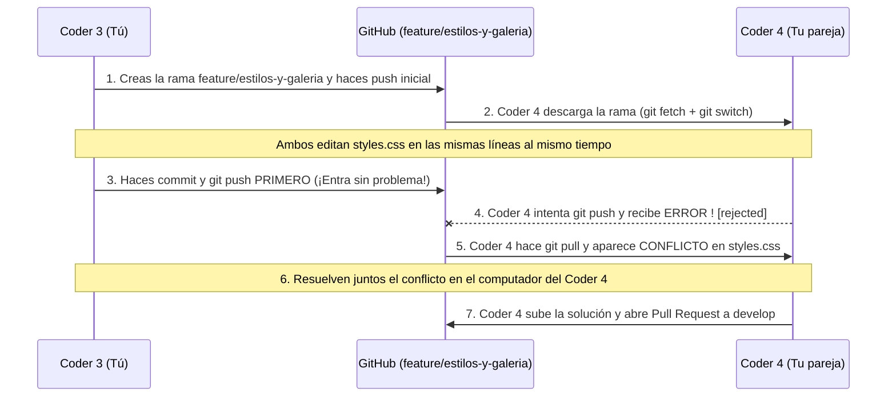

# 🦅 Guía del Coder 3: Especialista en Animales Aéreos

¡Bienvenido/a al equipo de desarrollo de **Animalia**! En este proyecto eres responsable del módulo de **Animales Aéreos** y formarás la **Pareja B** junto con el **Coder 4 (Animales Anfibios)**.

> [!NOTE]
> **Antes de empezar esta guía:**
> Asegúrate de que el Líder del Equipo haya terminado la **Etapa 0** del [README.md](./README.md), de haber aceptado la invitación en GitHub y de haber clonado el repositorio en tu computador (`git clone <URL>`, `cd animalia-gitflow` y `git switch develop`).

---

## 📌 Resumen de tus Entregas (Tu Backlog Personal)

| Historia | Descripción | Rama | Archivo que modificarás | Compañero de Revisión / Pareja |
| :--- | :--- | :--- | :--- | :--- |
| **HU-03** | Crear la página de **Animales Aéreos** con cabecera y fichas del Águila Real, Halcón Peregrino y Colibrí. | `feature/animales-aereos` | `aereos.html` | Revisa tu PR: **Coder 4** |
| **HU-06** | *(En pareja con Coder 4)* Modernizar el sistema de diseño visual (`styles.css`), provocando y resolviendo un conflicto de CSS en equipo. | `feature/estilos-y-galeria` | `styles.css` | Trabajo en pareja con **Coder 4** |

---

## 🚀 Etapa 1: Tu Historia de Usuario Individual (`HU-03`)

> **Historia de Usuario `HU-03`:**
> *Como visitante del portal Animalia, quiero una página dedicada a los animales aéreos para conocer aves rapaces y polinizadoras como el águila real, el halcón peregrino y el colibrí esmeralda.*

### Paso 1.1: Asegurarte de estar en `develop` y crear tu rama `feature`

1. En tu terminal dentro de la carpeta `animalia-gitflow`, asegúrate de estar en la rama `develop` actualizada:

```bash
git switch develop
git pull --no-rebase origin develop
```

2. Crea tu propia rama siguiendo el estándar **GitFlow** y cámbiate a ella:

```bash
git switch -c feature/animales-aereos
```

3. Comprueba con `git branch` que estás ubicado en `* feature/animales-aereos`.

> [!TIP]
> **¿Afecta esto a mis compañeros?**
> **No.** Como trabajas en tu propia rama (`feature/animales-aereos`) y sobre un archivo exclusivo (`aereos.html`), tus cambios están completamente aislados mientras los Coders 1, 2 y 4 construyen sus páginas.

---

### Paso 1.2: Primer Commit — Estructura base y primera especie (`aereos.html`)

1. Crea en la raíz del proyecto un archivo nuevo llamado **`aereos.html`**.
2. Copia y pega el siguiente código HTML inicial:

```html
<!DOCTYPE html>
<html lang="es">
<head>
  <meta charset="UTF-8">
  <meta name="viewport" content="width=device-width, initial-scale=1.0">
  <title>Animales Aéreos | Animalia</title>
  <link rel="stylesheet" href="styles.css">
</head>
<body>
  <header class="site-header">
    <div class="container header-content">
      <h1 class="logo">🐾 Animalia</h1>
      <nav class="main-nav">
        <a href="index.html">Inicio</a>
        <a href="acuaticos.html">Acuáticos</a>
        <a href="terrestres.html">Terrestres</a>
        <a href="aereos.html">Aéreos</a>
        <a href="anfibios.html">Anfibios</a>
      </nav>
    </div>
  </header>

  <main class="container">
    <section class="hero-banner">
      <h2>🦅 Reino de los Animales Aéreos</h2>
      <p>Conoce a las especies que dominan las corrientes térmicas, las grandes cumbres y los cielos del planeta.</p>
    </section>

    <section class="catalogo-section">
      <h2>Especies Destacadas de los Cielos</h2>
      <div class="card-grid">
        <article class="card">
          <h3>🦅 Águila Real</h3>
          <p>Una de las aves de presa más conocidas y poderosas de la Tierra, famosa por su agudeza visual y su majestuoso planeo en las montañas.</p>
          <span class="badge">Envergadura: Hasta 2.3 m</span>
        </article>
      </div>
    </section>
  </main>

  <footer class="site-footer">
    <p>Módulo desarrollado por Coder 3 &mdash; Enciclopedia Animalia</p>
  </footer>
</body>
</html>
```

3. Guarda el archivo y registra tu primer commit con **Conventional Commits**:

```bash
git status
git add aereos.html
git commit -m "feat(aereos): add base page structure and golden eagle card"
```

---

### Paso 1.3: Segundo Commit — Agregar Halcón Peregrino y Colibrí en `aereos.html`

1. Abre **`aereos.html`** y reemplaza **todo su contenido** por esta versión completa con las 3 especies:

```html
<!DOCTYPE html>
<html lang="es">
<head>
  <meta charset="UTF-8">
  <meta name="viewport" content="width=device-width, initial-scale=1.0">
  <title>Animales Aéreos | Animalia</title>
  <link rel="stylesheet" href="styles.css">
</head>
<body>
  <header class="site-header">
    <div class="container header-content">
      <h1 class="logo">🐾 Animalia</h1>
      <nav class="main-nav">
        <a href="index.html">Inicio</a>
        <a href="acuaticos.html">Acuáticos</a>
        <a href="terrestres.html">Terrestres</a>
        <a href="aereos.html">Aéreos</a>
        <a href="anfibios.html">Anfibios</a>
      </nav>
    </div>
  </header>

  <main class="container">
    <section class="hero-banner">
      <h2>🦅 Reino de los Animales Aéreos</h2>
      <p>Conoce a las especies que dominan las corrientes térmicas, las grandes cumbres y los cielos del planeta.</p>
    </section>

    <section class="catalogo-section">
      <h2>Especies Destacadas de los Cielos</h2>
      <div class="card-grid">
        <article class="card">
          <h3>🦅 Águila Real</h3>
          <p>Una de las aves de presa más conocidas y poderosas de la Tierra, famosa por su agudeza visual y su majestuoso planeo en las montañas.</p>
          <span class="badge">Envergadura: Hasta 2.3 m</span>
        </article>

        <article class="card">
          <h3>🪶 Halcón Peregrino</h3>
          <p>El ser vivo más rápido del planeta. En sus vuelos en picada para cazar puede superar los 300 kilómetros por hora.</p>
          <span class="badge">Picada: +320 km/h</span>
        </article>

        <article class="card">
          <h3>🐦 Colibrí Esmeralda</h3>
          <p>Capaz de batir sus alas hasta 80 veces por segundo, lo que le permite quedar suspendido en el aire e incluso volar hacia atrás.</p>
          <span class="badge">Aleteo: 80 veces/seg</span>
        </article>
      </div>
    </section>
  </main>

  <footer class="site-footer">
    <p>Módulo desarrollado por Coder 3 &mdash; Enciclopedia Animalia</p>
  </footer>
</body>
</html>
```

2. Guarda el archivo y realiza tu segundo commit:

```bash
git add aereos.html
git commit -m "feat(aereos): add peregrine falcon and hummingbird cards"
```

---

### Paso 1.4: Subir tu rama a GitHub y abrir tu Pull Request

1. Sube tu rama `feature/animales-aereos` a GitHub:

```bash
git push -u origin feature/animales-aereos
```

2. Ve al repositorio en GitHub:
   - Haz clic en **`Compare & pull request`** (o ve a **`Pull requests`** -> **`New pull request`**).
   - ⚠️ **¡Atención!** Asegúrate de cambiar la rama destino a **`develop`**:
     **`base: develop`** ⬅️ **`compare: feature/animales-aereos`**
   - **Título del PR:** `feat(aereos): complete aerial animals module (HU-03)`
   - **Descripción:** `Agrega la página aereos.html con las fichas del águila real, halcón peregrino y colibrí.`
   - En **`Reviewers`** (columna derecha), selecciona al **Coder 4**.
   - Haz clic en **`Create pull request`**.

> [!IMPORTANT]
> **🔔 Interacción con el Coder 4:**
> - Avísale al **Coder 4** que ya creaste tu Pull Request para que lo revise en *Files changed*, le dé a **`Approve`** y haga clic en **`Merge pull request`**.
> - **Tu tarea recíproca:** Cuando el **Coder 4** te asigne como revisor de su PR (`feature/animales-anfibios`), entra a **`Pull requests`**, revisa su archivo `anfibios.html`, selecciona **`Review changes` -> `Approve` -> `Submit review`** y haz el **`Merge pull request`**.

---

### 🏁 Punto de Control (Fin estimado de la Sesión 1)

Espera a que los **4 integrantes del equipo** hayan fusionado sus Pull Requests individuales (`HU-01` a `HU-04`) en `develop`. Cuando todos estén listos, regresa a tu rama `develop` y descarga los avances del equipo:

```bash
git switch develop
git pull --no-rebase origin develop
```

---

## 💥 Etapa 2: Trabajo en Pareja y Conflicto de Merge en CSS (`HU-06`)

> **Historia de Usuario `HU-06` (Pareja B: Coder 3 + Coder 4):**
> *Como visitante del sitio, quiero que la hoja de estilos global (`styles.css`) tenga una paleta de colores renovada, gradientes en el banner y animaciones al pasar el cursor por las tarjetas.*

En esta actividad trabajarás **al mismo tiempo que el Coder 4 sobre la misma rama (`feature/estilos-y-galeria`) y sobre el mismo archivo (`styles.css`)** para provocar y resolver un conflicto real de hojas de estilo.



---

### Paso 2.1: Crear y compartir la rama `feature/estilos-y-galeria`

1. Asegúrate de estar en `develop` actualizado:

```bash
git switch develop
git pull --no-rebase origin develop
```

2. Crea la rama compartida para la Pareja B y súbela a GitHub para que el **Coder 4** pueda conectarse a ella:

```bash
git switch -c feature/estilos-y-galeria
git push -u origin feature/estilos-y-galeria
```

> [!IMPORTANT]
> **🔔 Punto de Sincronización 1 con el Coder 4:**
> Dile al **Coder 4**: *"Ya subí la rama `feature/estilos-y-galeria` a GitHub"*.
> **Espera un momento** hasta que el Coder 4 ejecute `git fetch origin` y `git switch feature/estilos-y-galeria` en su computador. Cuando ambos estén sobre `feature/estilos-y-galeria`, pasen juntos al **Paso 2.2**.

---

### Paso 2.2: Modificar `styles.css` y hacer `push` PRIMERO

1. Abre el archivo **`styles.css`** en tu editor y reemplaza **todo su contenido** por el siguiente código (fíjate que estás cambiando las variables dentro de `:root`, el fondo de `.hero-banner` y el estilo de `.card`):

```css
/* =========================================================
   ZONA DE CONFLICTO PAREJA B (CODERS 3 Y 4): VARIABLES
   ========================================================= */
:root {
  --color-primario: #0f172a;
  --color-secundario: #0369a1;
  --color-acento: #38bdf8;
  --color-fondo: #f1f5f9;
  --color-texto: #1e293b;
  --color-blanco: #ffffff;
  --sombra-suave: 0 8px 20px rgba(15, 23, 42, 0.12);
}

* {
  box-sizing: border-box;
  margin: 0;
  padding: 0;
}

body {
  font-family: 'Segoe UI', Tahoma, Geneva, Verdana, sans-serif;
  background-color: var(--color-fondo);
  color: var(--color-texto);
  line-height: 1.6;
}

.container {
  max-width: 1050px;
  margin: 0 auto;
  padding: 0 20px;
}

.site-header {
  background-color: var(--color-primario);
  color: var(--color-blanco);
  padding: 18px 0;
  box-shadow: var(--sombra-suave);
}

.header-content {
  display: flex;
  justify-content: space-between;
  align-items: center;
  flex-wrap: wrap;
  gap: 12px;
}

.main-nav a {
  color: var(--color-blanco);
  text-decoration: none;
  margin-left: 16px;
  font-weight: 600;
  padding: 6px 12px;
  border-radius: 6px;
  transition: background-color 0.2s;
}

.main-nav a:hover {
  background-color: rgba(255, 255, 255, 0.2);
}

.hero-banner {
  background: linear-gradient(135deg, #0f172a 0%, #0369a1 100%);
  color: var(--color-blanco);
  padding: 48px 32px;
  border-radius: 16px;
  margin: 28px 0;
  text-align: center;
  box-shadow: var(--sombra-suave);
}

/* ZONA DE CONFLICTO PAREJA B: GRILLA Y TARJETAS */
.card-grid {
  display: grid;
  grid-template-columns: repeat(auto-fit, minmax(240px, 1fr));
  gap: 24px;
  margin: 24px 0 40px;
}

.card {
  background-color: var(--color-blanco);
  border-radius: 12px;
  padding: 24px;
  box-shadow: var(--sombra-suave);
  border-top: 5px solid var(--color-secundario);
}

.badge {
  display: inline-block;
  background-color: #e0f2fe;
  color: #0369a1;
  font-size: 0.85rem;
  font-weight: 700;
  padding: 6px 12px;
  border-radius: 999px;
  margin-top: 12px;
  text-decoration: none;
}

.site-footer {
  text-align: center;
  padding: 24px;
  background-color: #0f172a;
  color: #cbd5e1;
  margin-top: 40px;
}
```

2. Guarda el archivo `styles.css`, haz tu commit con el tipo **`style`** (recuerda que en Conventional Commits los cambios visuales de CSS llevan `style`) y **súbelo a GitHub antes que el Coder 4**:

```bash
git add styles.css
git commit -m "style(theme): update color palette and hero gradient for aerial theme"
git push origin feature/estilos-y-galeria
```

> [!WARNING]
> **🔔 ¡Acabas de afectar directamente al Coder 4!**
> Al subir tu commit primero a `feature/estilos-y-galeria`, dejaste desactualizada la copia local del **Coder 4**, quien está modificando las mismas líneas de `styles.css`.
>
> **¿Qué debes hacer ahora?**
> 1. Avísale al **Coder 4**: *"Ya subí mis cambios en `feature/estilos-y-galeria`, intenta hacer tu push"*.
> 2. Observa junto al **Coder 4** el error `! [rejected]` y el conflicto de merge que aparecerán en su pantalla, y ayúdale a resolverlo siguiendo la explicación a continuación.

---

### Paso 2.3: Entender el Error de Push y Resolver el Conflicto junto al Coder 4

En la terminal del **Coder 4** ocurrirán dos eventos clave que ambos deben analizar:

#### 1. El rechazo del `git push`:
```text
 ! [rejected]        feature/estilos-y-galeria -> feature/estilos-y-galeria (fetch first)
error: failed to push some refs to 'https://github.com/...'
```
- **¿Por qué ocurre?** Porque GitHub tiene tu commit (`style(theme): update color palette...`) y no permite que el Coder 4 lo pise sin antes descargarlo.

#### 2. El conflicto al ejecutar `git pull --no-rebase origin feature/estilos-y-galeria`:
```text
Auto-merging styles.css
CONFLICT (content): Merge conflict in styles.css
Automatic merge failed; fix conflicts and then commit the result.
```
Al abrir `styles.css`, verán que Git puso `<<<<<<< HEAD` (los colores esmeralda y efectos hover del Coder 4), `=======` y `>>>>>>> ...` (tus colores azul cielo y gradiente).

#### 3. Solución en equipo:
Ayúdale al **Coder 4** a combinar ambos estilos (el gradiente + las animaciones `hover` de las tarjetas) y a borrar todas las marcas `<<<<<<< HEAD`, `=======` y `>>>>>>>`, tal como se detalla en el Paso 2.4 de la guía del Coder 4.

---

### Paso 2.4: Revisar y Aprobar el Pull Request de la Pareja B

Cuando el **Coder 4** haya hecho el commit `fix(theme): resolve merge conflict in global variables and card grid styles`, haya subido la rama y haya creado el Pull Request hacia `develop`:

1. Opcionalmente, descarga en tu computador la solución final ejecutando:
   ```bash
   git pull --no-rebase origin feature/estilos-y-galeria
   ```
2. Entra a GitHub -> pestaña **`Pull requests`**.
3. Abre el Pull Request **`style(theme): modernize global stylesheet and card animations (HU-06)`** creado por el Coder 4.
4. Revisa la pestaña **`Files changed`** para confirmar que `styles.css` está limpio y sin marcadores de conflicto.
5. Haz clic en **`Review changes`** -> selecciona 🔘 **`Approve`** -> **`Submit review`**.
6. Haz clic en **`Merge pull request`** -> **`Confirm merge`**.

---

## 🎉 Cierre de tu Participación: Ir a la Etapa 3 Grupal

¡Excelente trabajo en equipo! Cuando la **Pareja A (Coders 1 y 2)** también haya fusionado su Pull Request en `develop`, reúnanse los 4 integrantes y completen la **Etapa 3: Lanzamiento Final a Producción (`develop` ➡️ `main`)** al final del archivo [README.md](./README.md).
