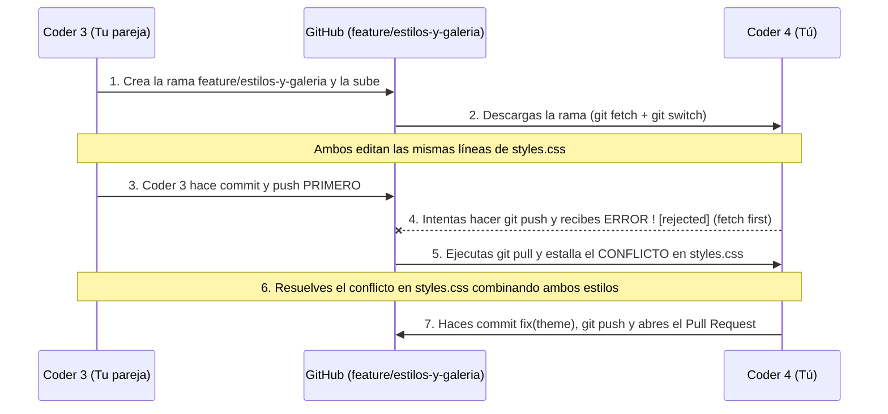

# 🐸 Guía del Coder 4: Especialista en Animales Anfibios

¡Bienvenido/a al equipo de desarrollo de **Animalia**! En este proyecto eres responsable del módulo de **Animales Anfibios** y formarás la **Pareja B** junto con el **Coder 3 (Animales Aéreos)**.

> [!NOTE]
> **Antes de empezar esta guía:**
> Asegúrate de que el Líder del Equipo haya terminado la **Etapa 0** del [README.md](./README.md), de haber aceptado la invitación en GitHub y de haber clonado el repositorio en tu computador (`git clone <URL>`, `cd animalia-gitflow` y `git switch develop`).

---

## 📌 Resumen de tus Entregas (Tu Backlog Personal)

| Historia | Descripción | Rama | Archivo que modificarás | Compañero de Revisión / Pareja |
| :--- | :--- | :--- | :--- | :--- |
| **HU-04** | Crear la página de **Animales Anfibios** con cabecera y fichas de la Rana Dardo, el Ajolote Mexicano y la Rana de Ojos Rojos. | `feature/animales-anfibios` | `anfibios.html` | Revisa tu PR: **Coder 3** |
| **HU-06** | *(En pareja con Coder 3)* Modernizar la hoja de estilos (`styles.css`), experimentar el error de `push` rechazado y **resolver el conflicto de merge en CSS**. | `feature/estilos-y-galeria` | `styles.css` | Trabajo en pareja con **Coder 3** |

---

## 🚀 Etapa 1: Tu Historia de Usuario Individual (`HU-04`)

> **Historia de Usuario `HU-04`:**
> *Como visitante del portal Animalia, quiero una página dedicada a los animales anfibios para conocer especies extraordinarias como la rana dardo dorada, el ajolote mexicano y la rana arbórea de ojos rojos.*

### Paso 1.1: Asegurarte de estar en `develop` y crear tu rama `feature`

1. En tu terminal dentro de la carpeta `animalia-gitflow`, asegúrate de estar en la rama `develop` actualizada:

```bash
git switch develop
git pull --no-rebase origin develop
```

2. Crea tu propia rama siguiendo el estándar **GitFlow** y cámbiate a ella:

```bash
git switch -c feature/animales-anfibios
```

3. Comprueba con `git branch` que estás ubicado en `* feature/animales-anfibios`.

> [!TIP]
> **¿Afecta esto a mis compañeros?**
> **No.** Al trabajar en tu propia rama (`feature/animales-anfibios`) y crear un archivo independiente (`anfibios.html`), no interferirás con el trabajo de los Coders 1, 2 y 3.

---

### Paso 1.2: Primer Commit — Estructura base y primera especie (`anfibios.html`)

1. Crea en la raíz del proyecto un archivo nuevo llamado **`anfibios.html`**.
2. Copia y pega el siguiente código HTML inicial:

```html
<!DOCTYPE html>
<html lang="es">
<head>
  <meta charset="UTF-8">
  <meta name="viewport" content="width=device-width, initial-scale=1.0">
  <title>Animales Anfibios | Animalia</title>
  <link rel="stylesheet" href="styles.css">
</head>
<body>
  <header class="site-header">
    <div class="container header-content">
      <h1 class="logo">🐾 Animalia</h1>
      <nav class="main-nav">
        <a href="index.html">Inicio</a>
        <a href="acuaticos.html">Acuáticos</a>
        <a href="terrestres.html">Terrestres</a>
        <a href="aereos.html">Aéreos</a>
        <a href="anfibios.html">Anfibios</a>
      </nav>
    </div>
  </header>

  <main class="container">
    <section class="hero-banner">
      <h2>🐸 Reino de los Animales Anfibios</h2>
      <p>Descubre a los maestros de la metamorfosis que habitan entre el agua dulce y los bosques tropicales.</p>
    </section>

    <section class="catalogo-section">
      <h2>Especies Destacadas del Mundo Anfibio</h2>
      <div class="card-grid">
        <article class="card">
          <h3>🐸 Rana Dardo Dorada</h3>
          <p>Endémica de la costa pacífica colombiana. Sus colores vibrantes advierten a los depredadores sobre su potente alcaloide defensivo.</p>
          <span class="badge">Hábitat: Selva Húmeda Tropical</span>
        </article>
      </div>
    </section>
  </main>

  <footer class="site-footer">
    <p>Módulo desarrollado por Coder 4 &mdash; Enciclopedia Animalia</p>
  </footer>
</body>
</html>
```

3. Guarda el archivo y registra tu primer commit con **Conventional Commits**:

```bash
git status
git add anfibios.html
git commit -m "feat(anfibios): add base page structure and poison dart frog card"
```

---

### Paso 1.3: Segundo Commit — Agregar Ajolote y Rana de Ojos Rojos en `anfibios.html`

1. Abre **`anfibios.html`** y reemplaza **todo su contenido** por esta versión completa con las 3 especies:

```html
<!DOCTYPE html>
<html lang="es">
<head>
  <meta charset="UTF-8">
  <meta name="viewport" content="width=device-width, initial-scale=1.0">
  <title>Animales Anfibios | Animalia</title>
  <link rel="stylesheet" href="styles.css">
</head>
<body>
  <header class="site-header">
    <div class="container header-content">
      <h1 class="logo">🐾 Animalia</h1>
      <nav class="main-nav">
        <a href="index.html">Inicio</a>
        <a href="acuaticos.html">Acuáticos</a>
        <a href="terrestres.html">Terrestres</a>
        <a href="aereos.html">Aéreos</a>
        <a href="anfibios.html">Anfibios</a>
      </nav>
    </div>
  </header>

  <main class="container">
    <section class="hero-banner">
      <h2>🐸 Reino de los Animales Anfibios</h2>
      <p>Descubre a los maestros de la metamorfosis que habitan entre el agua dulce y los bosques tropicales.</p>
    </section>

    <section class="catalogo-section">
      <h2>Especies Destacadas del Mundo Anfibio</h2>
      <div class="card-grid">
        <article class="card">
          <h3>🐸 Rana Dardo Dorada</h3>
          <p>Endémica de la costa pacífica colombiana. Sus colores vibrantes advierten a los depredadores sobre su potente alcaloide defensivo.</p>
          <span class="badge">Hábitat: Selva Húmeda Tropical</span>
        </article>

        <article class="card">
          <h3>🦎 Ajolote Mexicano</h3>
          <p>Salamandra extraordinaria que conserva sus rasgos larvales toda la vida y es capaz de regenerar extremidades y órganos completos.</p>
          <span class="badge">Capacidad: Regeneración Celular</span>
        </article>

        <article class="card">
          <h3>🌿 Rana Arbórea de Ojos Rojos</h3>
          <p>Habita las copas de los árboles en Centroamérica. Sus llamativos ojos escarlata desconciertan a los depredadores nocturnos.</p>
          <span class="badge">Hábito: Nocturno y Arborícola</span>
        </article>
      </div>
    </section>
  </main>

  <footer class="site-footer">
    <p>Módulo desarrollado por Coder 4 &mdash; Enciclopedia Animalia</p>
  </footer>
</body>
</html>
```

2. Guarda el archivo y realiza tu segundo commit:

```bash
git add anfibios.html
git commit -m "feat(anfibios): add axolotl and red-eyed tree frog cards"
```

---

### Paso 1.4: Subir tu rama a GitHub y abrir tu Pull Request

1. Sube tu rama `feature/animales-anfibios` a GitHub:

```bash
git push -u origin feature/animales-anfibios
```

2. Ve al repositorio en GitHub:
   - Haz clic en **`Compare & pull request`** (o ve a **`Pull requests`** -> **`New pull request`**).
   - ⚠️ **¡Atención!** Asegúrate de cambiar la rama destino a **`develop`**:
     **`base: develop`** ⬅️ **`compare: feature/animales-anfibios`**
   - **Título del PR:** `feat(anfibios): complete amphibian animals module (HU-04)`
   - **Descripción:** `Agrega la página anfibios.html con las fichas de la rana dardo dorada, ajolote mexicano y rana de ojos rojos.`
   - En **`Reviewers`** (columna derecha), selecciona al **Coder 3**.
   - Haz clic en **`Create pull request`**.

> [!IMPORTANT]
> **🔔 Interacción con el Coder 3:**
> - Pídele al **Coder 3** que revise, apruebe (**`Approve`**) y fusione (**`Merge`**) tu Pull Request.
> - **Tu tarea recíproca:** Entra a la pestaña **`Pull requests`**, abre el PR del **Coder 3** (`feature/animales-aereos`), revisa su archivo `aereos.html` en **`Files changed`**, haz clic en **`Review changes` -> `Approve` -> `Submit review`** y luego presiona **`Merge pull request`**.

---

### 🏁 Punto de Control (Fin estimado de la Sesión 1)

Cuando los **4 integrantes del equipo** hayan fusionado sus Pull Requests individuales (`HU-01` a `HU-04`) en `develop`, actualiza tu rama `develop` local:

```bash
git switch develop
git pull --no-rebase origin develop
```

---

## 💥 Etapa 2: Trabajo en Pareja, Error de Push y Resolución de Conflicto en CSS (`HU-06`)

> **Historia de Usuario `HU-06` (Pareja B: Coder 3 + Coder 4):**
> *Como visitante del sitio, quiero que la hoja de estilos global (`styles.css`) tenga una paleta de colores renovada, gradientes en el banner y animaciones al pasar el cursor por las tarjetas.*

En esta actividad trabajarás sobre la misma rama (`feature/estilos-y-galeria`) y el mismo archivo (`styles.css`) que el **Coder 3**. **Tú serás quien experimente en tu terminal el error de rechazo de `git push` y quien resuelva el conflicto de merge con ayuda del Coder 3.**



---

### Paso 2.1: Conectarte a la rama compartida `feature/estilos-y-galeria`

> [!IMPORTANT]
> **🔔 Punto de Sincronización 1 (Espera al Coder 3):**
> Espera a que el **Coder 3** te confirme que ya creó y subió a GitHub la rama `feature/estilos-y-galeria`.

Una vez que el Coder 3 te avise, consulta las ramas nuevas de GitHub y cámbiate a `feature/estilos-y-galeria`:

```bash
git fetch origin
git switch feature/estilos-y-galeria
```

Verifica con `git branch` que estás ubicado sobre `* feature/estilos-y-galeria`.

---

### Paso 2.2: Modificar las mismas líneas de `styles.css` y hacer tu commit local

1. Abre el archivo **`styles.css`** y reemplaza **todo su contenido** por este código (observa que estás editando las variables `:root`, `.hero-banner` y `.card` con tonos verde esmeralda y efectos `hover`, exactamente en las mismas líneas donde el Coder 3 está poniendo su paleta azul cielo):

```css
/* =========================================================
   ZONA DE CONFLICTO PAREJA B (CODERS 3 Y 4): VARIABLES
   ========================================================= */
:root {
  --color-primario: #064e3b;
  --color-secundario: #059669;
  --color-acento: #10b981;
  --color-fondo: #f0fdf4;
  --color-texto: #1e293b;
  --color-blanco: #ffffff;
  --sombra-suave: 0 6px 16px rgba(6, 78, 59, 0.12);
}

* {
  box-sizing: border-box;
  margin: 0;
  padding: 0;
}

body {
  font-family: 'Segoe UI', Tahoma, Geneva, Verdana, sans-serif;
  background-color: var(--color-fondo);
  color: var(--color-texto);
  line-height: 1.6;
}

.container {
  max-width: 1050px;
  margin: 0 auto;
  padding: 0 20px;
}

.site-header {
  background-color: var(--color-primario);
  color: var(--color-blanco);
  padding: 18px 0;
  box-shadow: var(--sombra-suave);
}

.header-content {
  display: flex;
  justify-content: space-between;
  align-items: center;
  flex-wrap: wrap;
  gap: 12px;
}

.main-nav a {
  color: var(--color-blanco);
  text-decoration: none;
  margin-left: 16px;
  font-weight: 600;
  padding: 6px 12px;
  border-radius: 6px;
  transition: background-color 0.2s;
}

.main-nav a:hover {
  background-color: rgba(255, 255, 255, 0.2);
}

.hero-banner {
  background: linear-gradient(135deg, #064e3b 0%, #059669 100%);
  color: var(--color-blanco);
  padding: 44px 30px;
  border-radius: 14px;
  margin: 28px 0;
  text-align: center;
}

/* ZONA DE CONFLICTO PAREJA B: GRILLA Y TARJETAS */
.card-grid {
  display: grid;
  grid-template-columns: repeat(auto-fit, minmax(230px, 1fr));
  gap: 22px;
  margin: 24px 0 40px;
}

.card {
  background-color: var(--color-blanco);
  border-radius: 12px;
  padding: 22px;
  box-shadow: var(--sombra-suave);
  border-top: 4px solid var(--color-acento);
  transition: transform 0.25s ease, box-shadow 0.25s ease;
}

.card:hover {
  transform: translateY(-6px);
  box-shadow: 0 12px 24px rgba(0, 0, 0, 0.14);
}

.badge {
  display: inline-block;
  background-color: #d1fae5;
  color: #065f46;
  font-size: 0.85rem;
  font-weight: 700;
  padding: 6px 12px;
  border-radius: 999px;
  margin-top: 12px;
  text-decoration: none;
}

.site-footer {
  text-align: center;
  padding: 24px;
  background-color: #0f172a;
  color: #cbd5e1;
  margin-top: 40px;
}
```

2. Guarda el archivo y registra tu commit local usando el tipo `style`:

```bash
git add styles.css
git commit -m "style(theme): add nature emerald palette and interactive card hover effects"
```

---

### Paso 2.3: Intentar hacer `git push` y analizar el Error de Rechazo

> [!IMPORTANT]
> **🔔 Punto de Sincronización 2 (Espera el push del Coder 3):**
> **Asegúrate de que el Coder 3 haya ejecutado su `git push origin feature/estilos-y-galeria` PRIMERO.**
> Cuando el Coder 3 te confirme que ya subió sus cambios, ejecuta tú el siguiente comando:

```bash
git push origin feature/estilos-y-galeria
```

#### 💥 ¡Mira tu terminal! Verás este mensaje de error:

```text
To https://github.com/lider/animalia-gitflow.git
 ! [rejected]        feature/estilos-y-galeria -> feature/estilos-y-galeria (fetch first)
error: failed to push some refs to 'https://github.com/lider/animalia-gitflow.git'
hint: Updates were rejected because the remote contains work that you do
hint: not have locally. This is usually caused by another repository pushing
hint: to the same ref. You may want to first integrate the remote changes
hint: (e.g., 'git pull ...') before pushing again.
```

**¿Por qué fue rechazado tu `git push`?**
Porque el **Coder 3** subió un commit nuevo a `feature/estilos-y-galeria` antes que tú. Git detecta que la rama remota en GitHub tiene commits que tú no has descargado aún y detiene el `push` para proteger el trabajo de tu compañero.

---

### Paso 2.4: Hacer `git pull` y Resolver el Conflicto de Merge en `styles.css`

1. Descarga e integra los cambios que subió el Coder 3 ejecutando:

```bash
git pull --no-rebase origin feature/estilos-y-galeria
```

2. **¡Aparece el conflicto!** En la terminal verás:

```text
Auto-merging styles.css
CONFLICT (content): Merge conflict in styles.css
Automatic merge failed; fix conflicts and then commit the result.
```

3. Abre **`styles.css`** en tu editor de código junto con el Coder 3. Verás las marcas de conflicto que Git insertó en `:root`, `.hero-banner` y `.card`:

```css
<<<<<<< HEAD
:root {
  --color-primario: #064e3b;
  --color-secundario: #059669;
  --color-acento: #10b981;
...
=======
:root {
  --color-primario: #0f172a;
  --color-secundario: #0369a1;
  --color-acento: #38bdf8;
...
>>>>>>> (hash del commit del Coder 3)
```

4. **Cómo solucionarlo:**
   - Vamos a **combinar lo mejor de los dos estilos** (un gradiente oceánico-esmeralda que representa tanto el cielo/mar como la selva + tus efectos `hover` en las tarjetas) y **eliminar todas las marcas** `<<<<<<< HEAD`, `=======` y `>>>>>>>`.
   - Reemplaza **todo el contenido de `styles.css`** por esta versión limpia y unificada:

```css
/* =========================================================
   SISTEMA DE DISEÑO UNIFICADO POR CODERS 3 Y 4
   ========================================================= */
:root {
  --color-primario: #0f172a;
  --color-secundario: #0369a1;
  --color-acento: #059669;
  --color-fondo: #f8fafc;
  --color-texto: #1e293b;
  --color-blanco: #ffffff;
  --sombra-suave: 0 8px 20px rgba(15, 23, 42, 0.12);
}

* {
  box-sizing: border-box;
  margin: 0;
  padding: 0;
}

body {
  font-family: 'Segoe UI', Tahoma, Geneva, Verdana, sans-serif;
  background-color: var(--color-fondo);
  color: var(--color-texto);
  line-height: 1.6;
}

.container {
  max-width: 1050px;
  margin: 0 auto;
  padding: 0 20px;
}

.site-header {
  background-color: var(--color-primario);
  color: var(--color-blanco);
  padding: 18px 0;
  box-shadow: var(--sombra-suave);
}

.header-content {
  display: flex;
  justify-content: space-between;
  align-items: center;
  flex-wrap: wrap;
  gap: 12px;
}

.main-nav a {
  color: var(--color-blanco);
  text-decoration: none;
  margin-left: 16px;
  font-weight: 600;
  padding: 6px 12px;
  border-radius: 6px;
  transition: background-color 0.2s;
}

.main-nav a:hover {
  background-color: rgba(255, 255, 255, 0.2);
}

.hero-banner {
  background: linear-gradient(135deg, #0f172a 0%, #0369a1 55%, #059669 100%);
  color: var(--color-blanco);
  padding: 48px 32px;
  border-radius: 16px;
  margin: 28px 0;
  text-align: center;
  box-shadow: var(--sombra-suave);
}

/* GRILLA Y TARJETAS INTERACTIVAS UNIFICADAS */
.card-grid {
  display: grid;
  grid-template-columns: repeat(auto-fit, minmax(230px, 1fr));
  gap: 24px;
  margin: 24px 0 40px;
}

.card {
  background-color: var(--color-blanco);
  border-radius: 12px;
  padding: 24px;
  box-shadow: var(--sombra-suave);
  border-top: 5px solid var(--color-acento);
  transition: transform 0.25s ease, box-shadow 0.25s ease;
}

.card:hover {
  transform: translateY(-6px);
  box-shadow: 0 12px 24px rgba(15, 23, 42, 0.16);
}

.badge {
  display: inline-block;
  background-color: #e0f2fe;
  color: #0369a1;
  font-size: 0.85rem;
  font-weight: 700;
  padding: 6px 12px;
  border-radius: 999px;
  margin-top: 12px;
  text-decoration: none;
}

.site-footer {
  text-align: center;
  padding: 24px;
  background-color: #0f172a;
  color: #cbd5e1;
  margin-top: 40px;
}
```

5. Guarda `styles.css`. Ahora marca el conflicto como solucionado con `git add`, haz el commit con `fix(theme)` y sube los cambios a GitHub:

```bash
git status
git add styles.css
git commit -m "fix(theme): resolve merge conflict in global variables and card grid styles"
git push origin feature/estilos-y-galeria
```

¡Verás que ahora el `git push` se completa con éxito!

---

### Paso 2.5: Crear el Pull Request de `feature/estilos-y-galeria` hacia `develop`

1. Entra al repositorio en GitHub -> **`Pull requests`** -> **`New pull request`**.
2. Selecciona las ramas:
   **`base: develop`** ⬅️ **`compare: feature/estilos-y-galeria`**
3. **Título del PR:** `style(theme): modernize global stylesheet and card animations (HU-06)`
4. **Descripción:** `Unifica la paleta de colores oceánico-esmeralda y las animaciones hover de las tarjetas en styles.css tras resolver el conflicto de merge en pareja.`
5. Asigna al **Coder 3** en **`Reviewers`** y haz clic en **`Create pull request`**.
6. Avísale al **Coder 3** para que lo apruebe (**`Approve`**) y haga el **`Merge pull request`**.

---

## 🎉 Cierre de tu Participación: Ir a la Etapa 3 Grupal

¡Excelente trabajo resolviendo el conflicto de estilos! Cuando ambas parejas hayan fusionado sus ramas en `develop`, reúnanse los 4 integrantes y sigan los pasos finales de la **Etapa 3: Lanzamiento Final a Producción (`develop` ➡️ `main`)** al final del archivo [README.md](./README.md).
